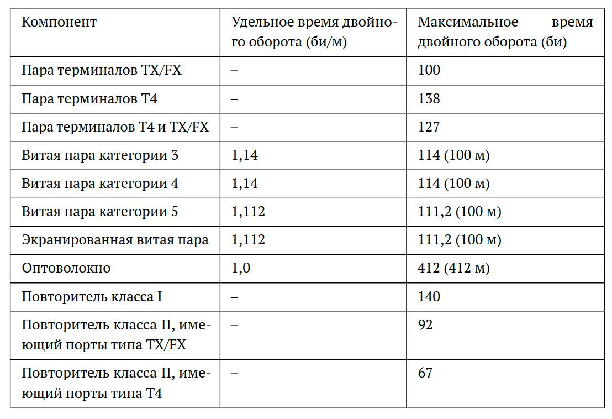

---
## Front matter
lang: ru-RU
title: Домашнее задание №2
subtitle: дз
author:
  - Кичигина Полина Евгеньевна
institute:
  - Российский университет дружбы народов, Москва, Россия
date: 26 сентября 2026

## i18n babel
babel-lang: russian
babel-otherlangs: english

## Formatting pdf
toc: false
toc-title: Содержание
slide_level: 2
aspectratio: 169
section-titles: true
theme: metropolis
header-includes:
 - \metroset{progressbar=frametitle,sectionpage=progressbar,numbering=fraction}
---

## Цель работы

Цель данной работы— изучение принципов технологий Ethernet и Fast Ethernet
и практическое освоение методик оценки работоспособности сети, построенной
на базе технологии Fast Ethernet.

## Выполнение

Исходные данные варианта № 1: все шесть сегментов выполнены на витой паре категории 5 по технологии 100BASE-TX, длины сегментов — 96, 92, 80, 5, 97 и 97 метров.

{#fig:001 width=70%}

##

Схема исследуемой сети Fast Ethernet: два повторителя класса II соединены сегментом 4, к первому подключены узлы 1–3, ко второму — узлы 4–5.

{#fig:002 width=70%}

##

Сумма длин всех сегментов равна 467 метров (превышает 205 м), а время двойного оборота для наихудшего пути равно 604,176 бит (превышает 512 бит) — сеть неработоспособна.

{#fig:003 width=60%}

## Выводы

Мы изучили принципы технологий Ethernet и Fast Ethernet
и практическое освоение методик оценки работоспособности сети, построенной
на базе технологии Fast Ethernet.

