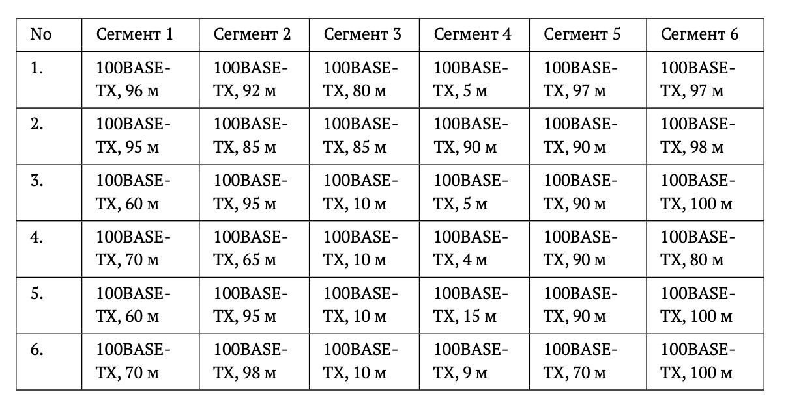
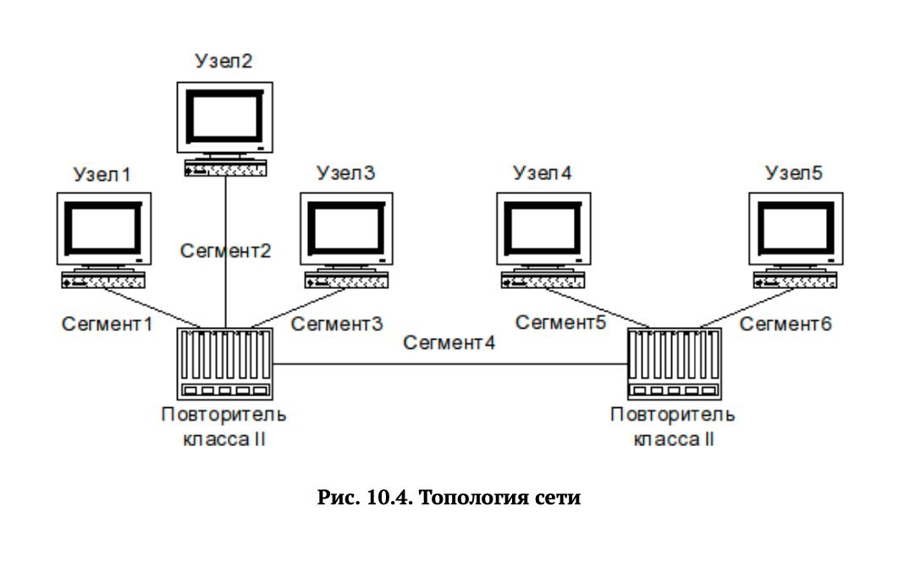

---
## Front matter
title: "Отчет по домашнему заданию №2"
subtitle: "Отчет"
author: "Кичигина Полина Евгеньевна"

## Generic otions
lang: ru-RU
toc-title: "Содержание"

## Bibliography
bibliography: bib/cite.bib
csl: pandoc/csl/gost-r-7-0-5-2008-numeric.csl

## Pdf output format
toc: true # Table of contents
toc-depth: 2
lof: true # List of figures
lot: true # List of tables
fontsize: 12pt
linestretch: 1.5
papersize: a4
documentclass: scrreprt
## I18n polyglossia
polyglossia-lang:
  name: russian
  options:
	- spelling=modern
	- babelshorthands=true
polyglossia-otherlangs:
  name: english
## I18n babel
babel-lang: russian
babel-otherlangs: english
## Fonts
mainfont: IBM Plex Serif
romanfont: IBM Plex Serif
sansfont: IBM Plex Sans
monofont: IBM Plex Mono
mathfont: STIX Two Math
mainfontoptions: Ligatures=Common,Ligatures=TeX,Scale=0.94
romanfontoptions: Ligatures=Common,Ligatures=TeX,Scale=0.94
sansfontoptions: Ligatures=Common,Ligatures=TeX,Scale=MatchLowercase,Scale=0.94
monofontoptions: Scale=MatchLowercase,Scale=0.94,FakeStretch=0.9
mathfontoptions:
## Biblatex
biblatex: true
biblio-style: "gost-numeric"
biblatexoptions:
  - parentracker=true
  - backend=biber
  - hyperref=auto
  - language=auto
  - autolang=other*
  - citestyle=gost-numeric
## Pandoc-crossref LaTeX customization
figureTitle: "Рис."
tableTitle: "Таблица"
listingTitle: "Листинг"
lofTitle: "Список иллюстраций"
lotTitle: "Список таблиц"
lolTitle: "Листинги"
## Misc options
indent: true
header-includes:
  - \usepackage{indentfirst}
  - \usepackage{float} # keep figures where there are in the text
  - \floatplacement{figure}{H} # keep figures where there are in the text
---

# Цель работы

Цель данной работы— изучение принципов технологий Ethernet и Fast Ethernet
и практическое освоение методик оценки работоспособности сети, построенной
на базе технологии Fast Ethernet.

# Выполнение

Исходные данные (Вариант 1)

Для расчёта выбран вариант № 1 из таблицы 10.4. Сеть состоит из двух повторителей класса II, соединённых между собой сегментом 4 длиной 5 метров. К первому повторителю подключены узлы 1, 2, 3 через сегменты 1, 2, 3 длиной 96, 92 и 80 метров соответственно. Ко второму повторителю подключены узлы 4 и 5 через сегменты 5 и 6 длиной 97 и 97 метров соответственно. Все сегменты выполнены на витой паре категории 5 по технологии 100BASE-TX. Топология сети представлена (рис. [-@fig:001])  (рис. [-@fig:002])

{#fig:001 width=70%}

{#fig:002 width=70%}

Проверка по первой модели

Первая модель проверяет предельно допустимый диаметр домена коллизий. Согласно таблице 10.1, для конфигурации с двумя повторителями класса II и всеми сегментами типа TX допустимый диаметр составляет 205 метров. Диаметр домена коллизий вычисляется как сумма длин всех сегментов: 96 + 92 + 80 + 5 + 97 + 97 = 467 метров. Полученное значение значительно превышает допустимые 205 метров. Следовательно, сеть не удовлетворяет первой модели.

Проверка по второй модели

Вторая модель основана на расчёте времени двойного оборота для наихудшего пути между двумя наиболее удалёнными узлами. В нашем случае наихудший путь проходит от узла 1 до узла 5 через сегменты 1, 4 и 6 и оба повторителя. Время двойного оборота складывается из задержек, вносимых парой терминалов TX/FX (100 бит), сегментами витой пары категории 5 (удельное время 1,112 би/м) и двумя повторителями класса II (по 92 бита каждый). Суммарное время двойного оборота составляет: 100 + 100 + 96×1,112 + 5×1,112 + 97×1,112 + 92 + 92 = 604,176 бит. Полученное значение превышает предельно допустимые 512 бит. Следовательно, сеть не удовлетворяет и второй модели. (рис. [-@fig:003])

{#fig:003 width=70%}

# Выводы

Мы изучили принципы технологий Ethernet и Fast Ethernet
и практическое освоение методик оценки работоспособности сети, построенной
на базе технологии Fast Ethernet.

