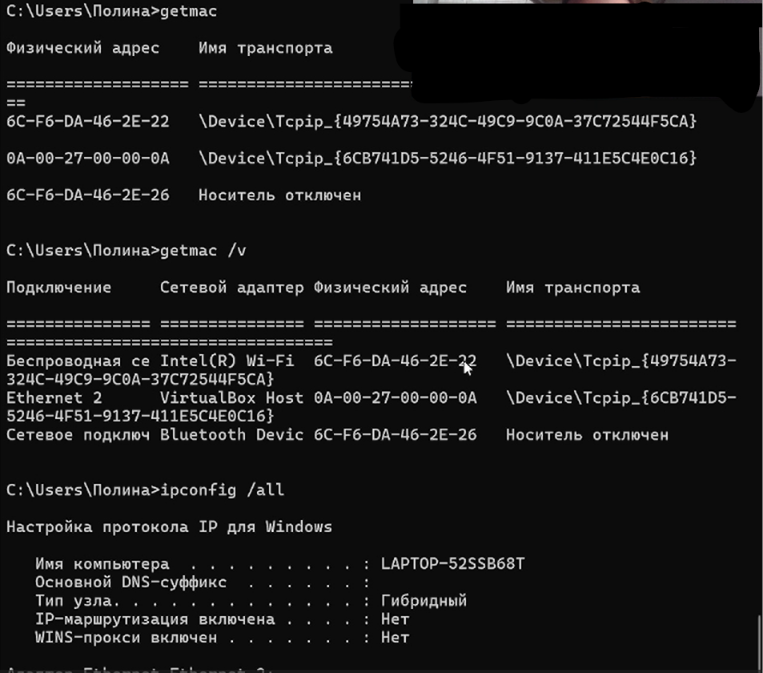
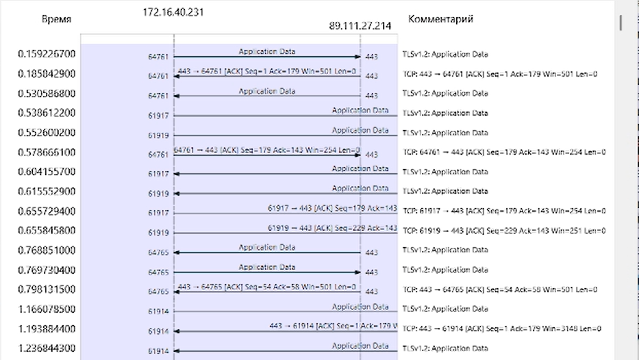

---
## Front matter
lang: ru-RU
title: Домашнее задание №3
author:
  - Кичигина Полина Евгеньевна
institute:
  - Российский университет дружбы народов, Москва, Россия
date: 10 октября 2026

## i18n babel
babel-lang: russian
babel-otherlangs: english

## Formatting pdf
toc: false
toc-title: Содержание
slide_level: 2
aspectratio: 169
section-titles: true
theme: metropolis
header-includes:
 - \metroset{progressbar=frametitle,sectionpage=progressbar,numbering=fraction}
---

## Цель работы

Изучение посредством Wireshark кадров Ethernet, анализ PDU протоколов
транспортного и прикладного уровней стека TCP/IP.

## Выполнение

MAC-адресация

Постановка задачи

1. Изучение возможностей команды ipconfig для ОС типа Windows (ifconfig
для систем типа Linux).
2. Определение MAC-адреса устройства и его типа.

## Порядок выполнения работы

1. С помощью команды ipconfig для ОС типа Windows или ifconfig для
систем типа Linux выведите информацию о текущем сетевом соединении. Используйте разные опции команды. Подтвердите свой ответ скриншотами.

{#fig:001 width=44%}

##

2. Определите MAC-адреса сетевых интерфейсов на вашем компьютере. Подтвердите свой ответ скриншотом.

{#fig:002 width=50%}

##

3. Опишите структуру MAC-адресов вашего устройства. Какая часть адреса идентифицирует производителя? Какая часть адреса идентифицирует сетевой
интерфейс? Определите, каким является адрес — индивидуальным или групповым, глобально администрируемым или локально администрируемым. 

{#fig:003 width=50%}

## Анализ кадров канального уровня в Wireshark

Постановка задачи

1. Установить на домашнем устройстве Wireshark.
2. С помощью Wireshark захватить и проанализировать пакеты ARP и ICMP
в части кадров канального уровня.

## Порядок выполнения работы

Начните новый процесс захвата трафика в Wireshark. На вашем устройстве
в консоли пропингуйте по имени какой-нибудь известный вам адрес, напри-
мер ping rudn.ru.

{#fig:004 width=70%}

## Анализ протоколов транспортного уровня в Wireshark

Постановка задачи

С помощью Wireshark захватить и проанализировать пакеты HTTP, DNS в части
заголовков и информации протоколов TCP, UDP, QUIC.

## Порядок выполнения работы

На вашем устройстве в браузере перейдите на сайт, работающий по протоколу
HTTP (например, на сайт CERN http://info.cern.ch/). Wireshark в строке фильтра укажите dns и проанализируйте информацию по
протоколу UDP в случае запросов и ответов. 

{#fig:005 width=60%}

## Анализ handshake протокола TCP в Wireshark

Постановка задачи

С помощью Wireshark проанализировать handshake протокола TCP.

## Порядок выполнения работы

На вашем устройстве или используйте подсоединение по telnet или ssh к вашему маршрутизатору, или соединение по HTTP с каким-то сайтом для захвата
в Wireshark пакетов TCP. В Wireshark в меню «Статистика» выберете «График Потока». 

{#fig:006 width=60%}

## Выводы

Мы изучили посредством Wireshark кадров Ethernet, анализ PDU протоколов
транспортного и прикладного уровней стека TCP/IP.
