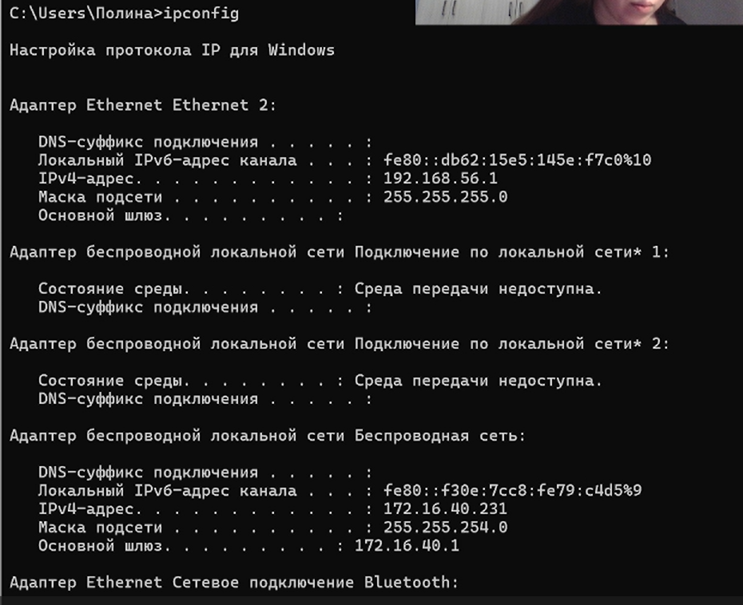
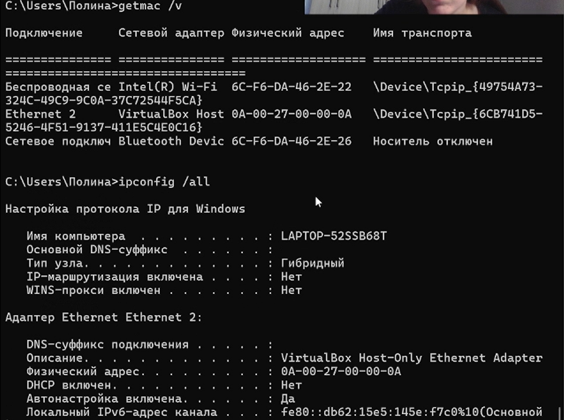
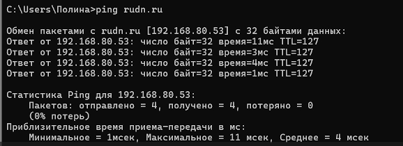
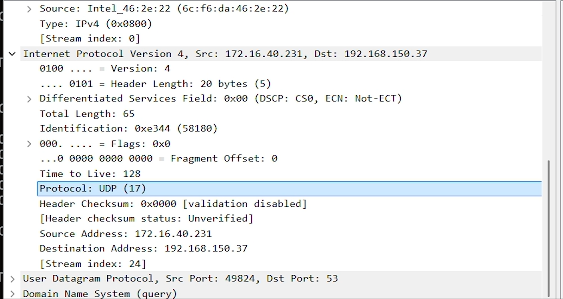

---
## Front matter
title: "Отчет"
subtitle: "Домашняя работа №3"
author: "Кичигина Полина Евгеньевна"

## Generic otions
lang: ru-RU
toc-title: "Содержание"

## Bibliography
bibliography: bib/cite.bib
csl: pandoc/csl/gost-r-7-0-5-2008-numeric.csl

## Pdf output format
toc: true # Table of contents
toc-depth: 2
lof: true # List of figures
lot: true # List of tables
fontsize: 12pt
linestretch: 1.5
papersize: a4
documentclass: scrreprt
## I18n polyglossia
polyglossia-lang:
  name: russian
  options:
	- spelling=modern
	- babelshorthands=true
polyglossia-otherlangs:
  name: english
## I18n babel
babel-lang: russian
babel-otherlangs: english
## Fonts
mainfont: IBM Plex Serif
romanfont: IBM Plex Serif
sansfont: IBM Plex Sans
monofont: IBM Plex Mono
mathfont: STIX Two Math
mainfontoptions: Ligatures=Common,Ligatures=TeX,Scale=0.94
romanfontoptions: Ligatures=Common,Ligatures=TeX,Scale=0.94
sansfontoptions: Ligatures=Common,Ligatures=TeX,Scale=MatchLowercase,Scale=0.94
monofontoptions: Scale=MatchLowercase,Scale=0.94,FakeStretch=0.9
mathfontoptions:
## Biblatex
biblatex: true
biblio-style: "gost-numeric"
biblatexoptions:
  - parentracker=true
  - backend=biber
  - hyperref=auto
  - language=auto
  - autolang=other*
  - citestyle=gost-numeric
## Pandoc-crossref LaTeX customization
figureTitle: "Рис."
tableTitle: "Таблица"
listingTitle: "Листинг"
lofTitle: "Список иллюстраций"
lotTitle: "Список таблиц"
lolTitle: "Листинги"
## Misc options
indent: true
header-includes:
  - \usepackage{indentfirst}
  - \usepackage{float} # keep figures where there are in the text
  - \floatplacement{figure}{H} # keep figures where there are in the text
---

# Цель работы

Изучение посредством Wireshark кадров Ethernet, анализ PDU протоколов
транспортного и прикладного уровней стека TCP/IP.

# Выполнение

MAC-адресация

Постановка задачи

1. Изучение возможностей команды ipconfig для ОС типа Windows (ifconfig
для систем типа Linux).
2. Определение MAC-адреса устройства и его типа.

Порядок выполнения работы

1. С помощью команды ipconfig для ОС типа Windows или ifconfig для
систем типа Linux выведите информацию о текущем сетевом соединении. Ис-
пользуйте разные опции команды. Подтвердите свой ответ скриншо-
тами.(рис. [-@fig:001]) 

{#fig:001 width=70%}

2. Определите MAC-адреса сетевых интерфейсов на вашем компьютере. Под-
твердите свой ответ скриншотом.(рис. [-@fig:002])

{#fig:002 width=70%}

3. Опишите структуру MAC-адресов вашего устройства. Какая часть адреса иден-
тифицирует производителя? Какая часть адреса идентифицирует сетевой
интерфейс? Определите, каким является адрес — индивидуальным или груп-
повым, глобально администрируемым или локально администрируемым. (рис. [-@fig:003])

{#fig:003 width=70%}

Анализ кадров канального уровня в Wireshark

Постановка задачи

1. Установить на домашнем устройстве Wireshark.
2. С помощью Wireshark захватить и проанализировать пакеты ARP и ICMP
в части кадров канального уровня.

Порядок выполнения работы

1. Установите на вашем устройстве Wireshark.
2. Запустите Wireshark. Выберите активный на вашем устройстве сетевой ин-
терфейс. Убедитесь, что начался процесс захвата трафика.

3. На вашем устройстве в консоли определите с помощью команды ipconfig
для ОС типа Windows или ifconfig для систем типа Linux IP-адрес вашего
устройства и шлюз по умолчанию (default gateway).
4. На вашем устройстве в консоли с помощью команды ping адрес_шлюза
пропингуйте шлюз по умолчанию. Для остановки процесса используйте ком-
бинацию клавиш Ctrl + c или изначально при помощи параметров команды
ping задайте число сообщений эхо-запроса.
5. В Wireshark остановите захват трафика. В строке фильтра пропишите фильтр
arp or icmp. Убедитесь, что в списке пакетов отобразятся только пакеты
ARP или ICMP, в частности пакеты, которые были сгенерированы с помощью
команды ping, отправленной с вашего устройства на шлюз по умолчанию.
6. Изучите эхо-запрос и эхо-ответ ICMP в программе Wireshark:
– На панели списка пакетов (верхний раздел) выберите первый указанный
кадр ICMP — эхо-запрос. Изучите информацию на панели сведений о па-
кете в средней части экрана. В отчёте укажите длину кадра, к какому типу
Ethernet относится кадр, определите MAC-адреса источника и шлюза, опре-
делите тип MAC-адресов.
– На панели списка пакетов (верхний раздел) выберите второй указанный
кадр ICMP — эхо-ответ. Изучите информацию на панели сведений о паке-
те в средней части экрана. В отчёте укажите длину кадра, к какому типу
Ethernet относится кадр, определите MAC-адреса источника и шлюза, опре-
делите тип MAC-адресов.
7. Изучите кадры данных протокола ARP. Изучите данные в полях заголовка
Ethernet II.
8. Начните новый процесс захвата трафика в Wireshark. На вашем устройстве
в консоли пропингуйте по имени какой-нибудь известный вам адрес, напри-
мер ping rudn.ru.(рис. [-@fig:004])

{#fig:004 width=70%}

9. В Wireshark остановите захват трафика. Изучите запросы и ответы протоколов
ARP и ICMP. Определите MAC-адреса источника и получателя, определите
тип MAC-адресов.

Анализ протоколов транспортного уровня
в Wireshark

Постановка задачи

С помощью Wireshark захватить и проанализировать пакеты HTTP, DNS в части
заголовков и информации протоколов TCP, UDP, QUIC.

Порядок выполнения работы

1. Запустите Wireshark. Выберите активный на вашем устройстве сетевой ин-
терфейс. Убедитесь, что начался процесс захвата трафика.
2. На вашем устройстве в браузере перейдите на сайт, работающий по протоколу
HTTP (например, на сайт CERN http://info.cern.ch/). При необходимо-
сти получения большей информации для Wireshark поперемещайтесь по
ссылкам или разделам сайта в браузере.
3. В Wireshark в строке фильтра укажите http и проанализируйте информацию
по протоколу TCP в случае запросов и ответов. В отчёте приведите пояснение
по информации, захваченной в Wireshark.
4. Wireshark в строке фильтра укажите dns и проанализируйте информацию по
протоколу UDP в случае запросов и ответов. В отчёте приведите пояснение
по информации, захваченной в Wireshark.(рис. [-@fig:005])

{#fig:005 width=70%}

5. Wireshark в строке фильтра укажите quic и проанализируйте информацию по
протоколу quic в случае запросов и ответов. В отчёте приведите пояснение
по информации, захваченной в Wireshark.
6. Остановите захват трафика в Wireshark.

Анализ handshake протокола TCP в Wireshark

Постановка задачи

С помощью Wireshark проанализировать handshake протокола TCP.

Порядок выполнения работы

1. Запустите Wireshark. Выберите активный на вашем устройстве сетевой ин-
терфейс. Убедитесь, что начался процесс захвата трафика.
2. На вашем устройстве или используйте подсоединение по telnet или ssh к ва-
шему маршрутизатору (например с помощью PUTTY или соответствующих
команд в консоли), или соединение по HTTP с каким-то сайтом для захвата
в Wireshark пакетов TCP.
3. В Wireshark проанализируйте handshake протокола TCP, в отчёте приведите
пример с пояснениями изменения значений соответствующих сообщений
при установлении соединения по TCP.
4. В Wireshark в меню «Статистика» выберете «График Потока». 
5. Остановите захват трафика в Wireshark.(рис. [-@fig:006])

{#fig:006 width=70%}

# Выводы

Мы изучили посредством Wireshark кадров Ethernet, анализ PDU протоколов
транспортного и прикладного уровней стека TCP/IP.
