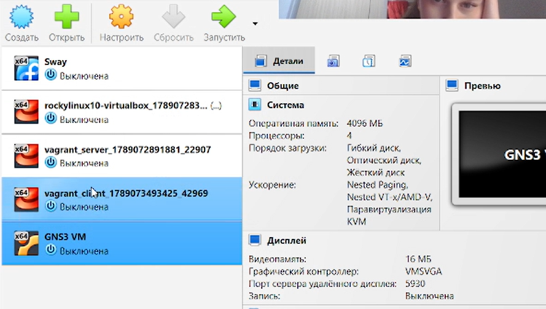
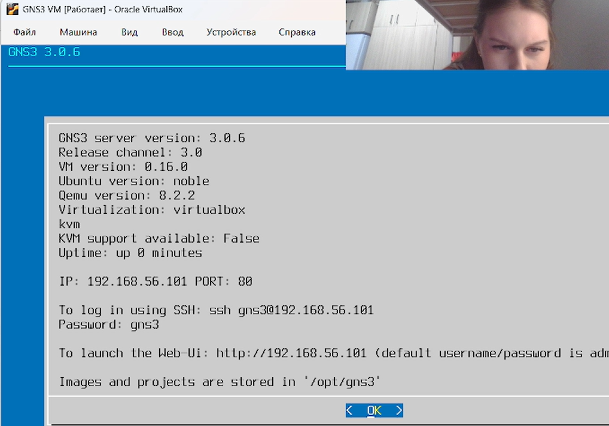
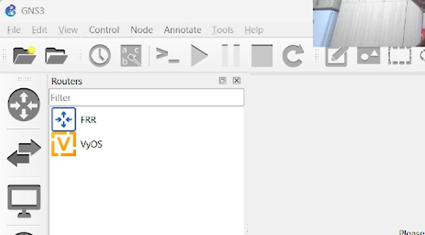
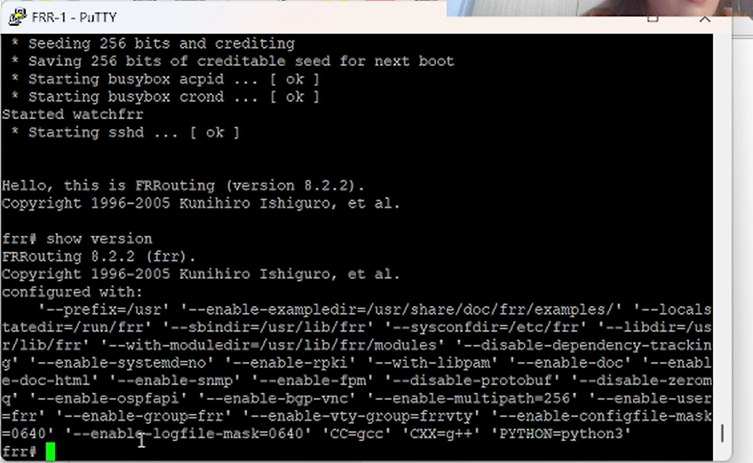

---
## Front matter
lang: ru-RU
title: Лабороторная работа № 1
author:
  - Кичигина Полина Евгеньевна
institute:
  - Российский университет дружбы народов, Москва, Россия
date: 12 сентября 2026

## i18n babel
babel-lang: russian
babel-otherlangs: english

## Formatting pdf
toc: false
toc-title: Содержание
slide_level: 2
aspectratio: 169
section-titles: true
theme: metropolis
header-includes:
 - \metroset{progressbar=frametitle,sectionpage=progressbar,numbering=fraction}
---

## Цель работы

Установка и настройка GNS3 и сопутствующего программного обеспечения.

## Задания для выполнения

1. Установить GNS3-all-in-one, GNS3 VM, проверить корректность запуска.
2. Импортировать в GNS3 образ маршрутизатора FRR.
3. Импортировать в GNS3 образ маршрутизатора VyOS.
4. Проверить корректность работы маршрутизаторов FRR и VyOS.

## Выполнение лабораторной работы

Установка GNS3-all-in-one
При установке GNS3 через менеджер пакетов Chocolatey для ОС Windows В командной строке введите:
choco install gns3 -y

{#fig:001 width=65%}

## 

Установка GNS3 VM для VirtualBox

{#fig:002 width=70%}

## 

Запуск экземпляра GNS3 в VirtualBox
Запустите GNS3 VM в VirtualBox 

{#fig:003 width=65%}

##

В вашей основной операционной системе запустите приложение gns3 и настройте локальный сервер.

{#fig:004 width=60%}

##

Добавление образа маршрутизатора FRR.
Добавление образа маршрутизатора VyOS.

{#fig:005 width=70%}

##

Проверка работоспособности установленного ПО

{#fig:006 width=70%}

##

{#fig:007 width=70%}

# Выводы
Мы установили и настроили GNS3 и сопутствующие программное обеспечение.

## {.standout}

Спасибо за внимание!
