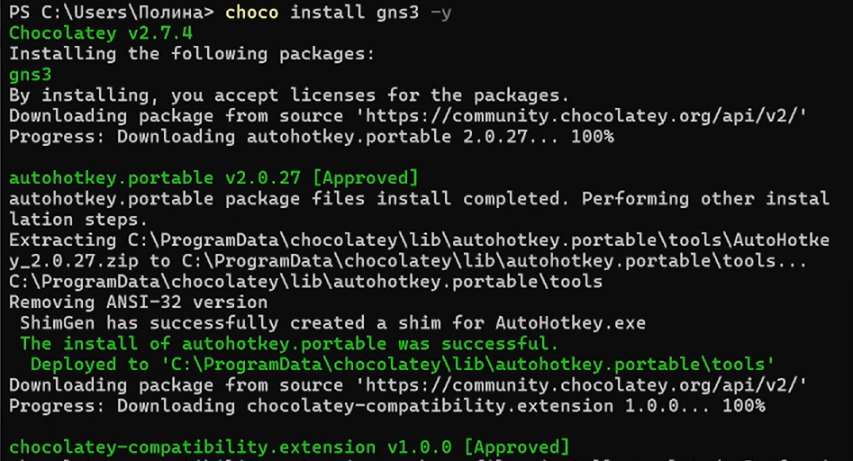
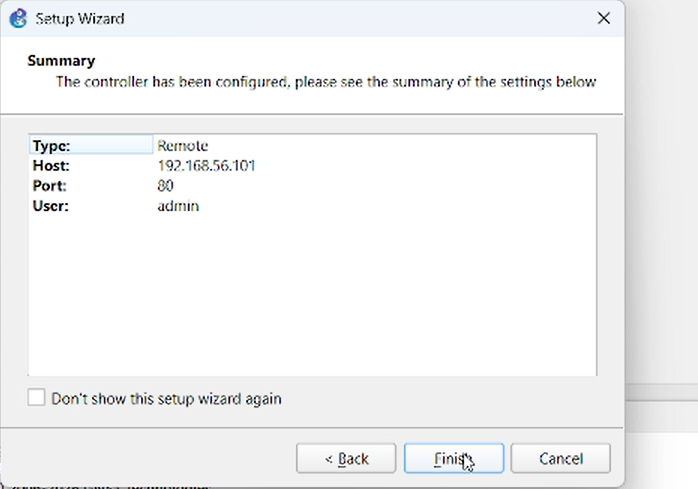
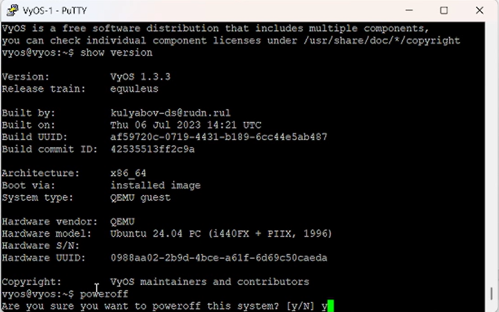

---
## Front matter
title: " Отчёт по лабораторной работе №1"
subtitle: "Отчет"
author: "Кичигина Полина Евгеньевна"

## Generic otions
lang: ru-RU
toc-title: "Содержание"

## Bibliography
bibliography: bib/cite.bib
csl: pandoc/csl/gost-r-7-0-5-2008-numeric.csl

## Pdf output format
toc: true # Table of contents
toc-depth: 2
lof: true # List of figures
lot: true # List of tables
fontsize: 12pt
linestretch: 1.5
papersize: a4
documentclass: scrreprt
## I18n polyglossia
polyglossia-lang:
  name: russian
  options:
	- spelling=modern
	- babelshorthands=true
polyglossia-otherlangs:
  name: english
## I18n babel
babel-lang: russian
babel-otherlangs: english
## Fonts
mainfont: IBM Plex Serif
romanfont: IBM Plex Serif
sansfont: IBM Plex Sans
monofont: IBM Plex Mono
mathfont: STIX Two Math
mainfontoptions: Ligatures=Common,Ligatures=TeX,Scale=0.94
romanfontoptions: Ligatures=Common,Ligatures=TeX,Scale=0.94
sansfontoptions: Ligatures=Common,Ligatures=TeX,Scale=MatchLowercase,Scale=0.94
monofontoptions: Scale=MatchLowercase,Scale=0.94,FakeStretch=0.9
mathfontoptions:
## Biblatex
biblatex: true
biblio-style: "gost-numeric"
biblatexoptions:
  - parentracker=true
  - backend=biber
  - hyperref=auto
  - language=auto
  - autolang=other*
  - citestyle=gost-numeric
## Pandoc-crossref LaTeX customization
figureTitle: "Рис."
tableTitle: "Таблица"
listingTitle: "Листинг"
lofTitle: "Список иллюстраций"
lotTitle: "Список таблиц"
lolTitle: "Листинги"
## Misc options
indent: true
header-includes:
  - \usepackage{indentfirst}
  - \usepackage{float} # keep figures where there are in the text
  - \floatplacement{figure}{H} # keep figures where there are in the text
---

# Цель работы

Установка и настройка GNS3 и сопутствующего программного обеспечения.

# Задания для выполнения

1. Установить GNS3-all-in-one, GNS3 VM, проверить корректность запуска.
2. Импортировать в GNS3 образ маршрутизатора FRR.
3. Импортировать в GNS3 образ маршрутизатора VyOS.
4. Проверить корректность работы маршрутизаторов FRR и VyOS.

# Выполнение лабораторной работы

Установка GNS3-all-in-one

GNS3 можно установить или напрямую, взяв файл с необходимой верси-
ей с репозитория https://github.com/GNS3/gns3-gui/releases, или вос-
пользоваться менеджером пакетов: для операционной системы Windows — это
Chocolatey, для Linux — зависит от дистрибутива (для Ubuntu — это apt, для
Fedora, Rocky или CentOS — это dnf или rpm, для Debian — dpkg).
Подробное описание процесса установки для различных платформ доступно
на сайте GNS3 — https://docs.gns3.com/docs/.
При установке GNS3 через менеджер пакетов Chocolatey для ОС Windows:
– Запустите PowerShell с полномочиями администратора.
– В командной строке введите:
choco install gns3 -y(рис. [-@fig:001])

{#fig:001 width=70%}

– После запуска графического окна по установке следуйте указаниям, нажимая
Next , принимая соглашение по лицензии, выбирая отображение названия ка-
талога в стартовом меню (можно оставить выдаваемое по умолчанию). В про-
цессе установки при выборе комплектации требуется отметить MSVC Runtime
(отмечено по умолчанию), GNS3-Desktop, GNS3-VM, Tools. Затем требуется
указать расположение устанавливаемого пакета (можно оставить выдаваемое
по умолчанию). В следующем окне требуется отметить тот тип виртуальной
машины, через которую в дальнейшем вы будете работать с GNS3 (VirtualBox,
VMware, Hyper-V или KVM). После выбора типа виртуальной машины следует
нажать Inslall . Начнётся процесс установки GNS3 и дополнительных пакетов.
Королькова А. В., Кулябов Д. С. Сетевые технологии. Лабораторный практикум 9
При необходимости следует нажимать Next , принимать соглашение по ли-
цензии для устанавливаемого программного обеспечения. В конце процесса
установки появится окно с предложением запуска GNS3 после установки,
следует снять галочку (т.е. не требуется запуск), нажать Finish .
– Если в вашей операционной системе не установлен выбранный вами тип
виртуальной машины, например VirlualBox, то необходимо уставить его через
менеджер пакетов. В случае выбора VirlualBox это можно сделать командой
choco install virtualbox -y

Установка GNS3 VM для VirtualBox

В этом разделе достаточно подробно приведено описание установки GNS3 VM
для VirtualBox. Тип виртуальной машины можно заменить и на другой (VMware,
Hyper-V или KVM), процесс установки несильно отличается, но естественно будет
иметь свои особенности.
Следует учитывать, что версия виртуальной машины GNS3 VM должна соответ-
ствовать версии клиентской и серверной частей GNS3-all-in-one. Загрузить соот-
ветствующую версию можно или с сайта GNS3 https://gns3.com/software/
download-vm, или с git-репозитория https://github.com/GNS3/gns3-gui/
releases.
Процесс установки:
– Перейдите в каталог, в который скачан архив с образом виртуальной машины
GNS3.VM.VirtualBox.номер-версии.zip. Распакуйте архив с образом.
– Запустите VirtualBox. Выберете меню Файл Импорт конфигураций... . Укажите
месторасположение распакованного образа GNS3 VM.ova. В следующем окне
в параметрах импорта выберете в политике MAC-адреса «Сгенерировать
новые MAC-адреса всех сетевых адаптеров». Нажмите Импорт .
– Уточните параметры настройки виртуальной машины GNS3 VM в VirtualBox.
Для этого в VirtualBox выберете импортированную виртуальную машину и пе-
рейдите в меню Машина Настроить . Перейдите к опции «Система». Если внизу
этого окна есть сообщение об обнаружении неправильных настроек, то, сле-
дуя рекомендациям, внесите исправления. Например, может потребоваться
увеличить видеопамять виртуальной машины и изменить тип графического
контроллера на рекомендуемый VMSVGA. Минимальные ресурсы для вирту-
альной машины: основная память — не менее 4096 МБ, число процессоров —
не менее 2 ЦП.
– Настройте вложенную виртуализацию в VirtualBox. Для этого в VirtualBox вы-
берете импортированную виртуальную машину и перейдите в меню Машина
Настроить . Перейдите к опции «Система» и вкладке «Процессор». Убедитесь,
что нет возможности в графическом интерфейсе отметить флажок «Включить
Nested VT-x/AMD-V». Для включения вложенной виртуализации воспользуй-
тесь командной строкой терминала и введите команду:
vboxmanage modifyvm "GNS3 VM" --nested-hw-virt on

 (рис. [-@fig:002])

{#fig:002 width=70%}

Запуск экземпляра GNS3 в VirtualBox

GNS3 получает параметры виртуальной машины, запрашивая свойства VirtualBox.
Начиная с версии Virtualbox-7 эти свойства отображаются в текущей локали
пользователя. Вы в этом можете убедиться, запустив:
VBoxManage list systemproperties
Для корректной работы gns3 необходимо отображать эту информацию на ан-
глийском. Поэтому следует задать кодировку для отображения свойств VirtualBox:
VBoxManage setproperty language C
Запустите GNS3 VM в VirtualBox (рис. 1.5). Затем в вашей основной операци-
онной системе запустите приложение gns3 ( (рис. [-@fig:003])

{#fig:003 width=70%}

При первом запуске приложения gns3 запускается мастер настройки, в кото-
ром следует выбрать первый способ работы с gns3 — «Run appliance in a virtual
machine» (т.е. запуск устройства на виртуальной машине), нажать Next (рис. 1.6).
В следующем окне указываются настройки локального сервера. Путь к серверу
оставьте без изменений. В случае старых версий 2.x.x gns3 используется порт
3080 TCP, в случае gns3 версии 3.x.x используется порт 80 TCP. Выберете IP-адрес
привязки хоста, находящегося в подсети VirtualBox (рис. 1.7), затем нажмите
Next .
После успешного подсоединения должно появиться окно с итоговыми на-
стройками, на котором следует нажать (рис. [-@fig:004])

{#fig:004 width=70%}

Добавление образа маршрутизатора FRR

Предположим, что требуется добавить образ маршрутизатора (FRRouting).
В рабочем пространстве GNS3 на левой боковой панели выберете просмотр
маршрутизаторов (Browse Routers), затем нажмите на + New template.
В рабочем пространстве на левой панели в списке маршрутизаторов появится
образ устройства FRR.
Далее необходимо настроить образ маршрутизатора. Правой кнопкой мыши
щёлкните на образе устройства, в меню выберете Configure template (рис. 1.18).
В открывшемся окне необходимо во вкладке «General settings» (рис. 1.19) в по-
ле «On close» выбрать Send the shutdown signal (ACPI) . Во вкладке «HDD» (рис. 1.20)
необходимо поставить галочку «Automatically create a config disk on HDD».

Добавление образа маршрутизатора VyOS

Предположим, что в GNS3 требуется добавить образ платформы маршрутиза-
ции VyOS (https://vyos.net/).
Платформа VyOS реализована на основе дистрибутива Debian, система команд
в ней похожа на Juniper (JunOS). VyOS можно разворачивать на большинстве
популярных платформ в виде виртуальной машины, непосредственно на аппа-
ратном обеспечении или в облаке. Образ занимает около 300 МБ.
VyOS можно собрать самостоятельно из исходного кода или скачать в виде
собранного и оттестированного образа для определённой платформы. Начиная
с версии 1.2 GA- и LTS-образы возможно скачать за плату. Для учебных заведе-
ний и некоммерческих организаций возможен бесплатный доступ к релизам.
Образы для rolling-релизов можно скачивать бесплатно (https://vyos.net/
get/?dir=rolling/current/amd64, https://community.vyos.net/get/).
Для целей данного практикума потребуется VyOS-1.3.3, образ можно взять
с репозитория https://github.com/yamadharma/dyos-build/releases.
Как и в случае с добавлением образа FRR в рабочем пространстве GNS3 на
левой боковой панели выберете просмотр маршрутизаторов (Browse Routers),
затем нажмите на + New template (рис. 1.10). В открывшемся окне укажите, что
образ следует устанавливать с GNS3-сервера (рис. 1.11).
В следующем окне выберете Routers и образ VyOS, нажмите Install . Далее
укажите, что устанавливать образ следует на виртуальную машину GNS3 VM
(рис. 1.13). Далее предлагается выбор эмулятора, оставляем предложенное, на-
жимаем Next .
В следующем окне предлагается перечень файлов для скачивания и последую-
щей установки. Выберете, например, VyOS Universal Router version 1.3.7, нажмите
Create a new version , далее укажите название версии 1.3.3 и нажмите OK . Далее
укажите название образа vyos-1.3.3-amd64.qcow2 и нажмите OK . В следующем
окне выберите vyos-1.3.3-amd64.qcow2 и нажмите Import , далее выберете ранее
загруженный файл vyos-1.3.3-amd64.qcow2 и установите его. На заключительном
окне указывается краткая информация об устройстве, просмотрите и нажмите
Finish .
Далее необходимо настроить образ маршрутизатора. Правой кнопкой мыши
щёлкните на образе устройства, в меню выберете Configure template . В открыв-
шемся окне необходимо во вкладке «General settings» в поле «On close» выбрать
Send the shutdown signal (ACPI) . Во вкладке «HDD» необходимо поставить галочку
«Automatically create a config disk on HDD».(рис. [-@fig:005])

{#fig:005 width=70%}

Проверка работоспособности установленного ПО

– В GNS3 создайте новый проект File,New blank project , назовите его, например,
PR-01.
– В рабочей области GNS3 разместите маршрутизатор FRR.
– В рабочей области GNS3 щёлкнув на изображении маршрутизатора FRR пра-
вой кнопкой мыши выберете в меню сначала Start , затем аналогичным
образом в меню выберете Console .
– В случае корректного запуска маршрутизатора и консоли в терминале должно
появиться приглашение для работы вида frr# (см. рис. 1.21).
– В терминале введите show version.
– Для выключения FRR в рабочей области GNS3 щёлкните на изображении
маршрутизатора FRR правой кнопкой мыши выберете в меню Stop , терминал
с доступом к FRR автоматически закроется.(рис. [-@fig:006])

{#fig:006 width=70%}

– Аналогичным образом разместите в рабочей области маршрутизатор VyOS,
запустите его, откройте терминал и убедитесь в корректном запуске.
– В случае корректного запуска маршрутизатора и консоли в терминале должно
появиться приглашение для работы вида
vyos login:
– В терминале введите логин vyos и пароль vyos. Затем введите show version.
Версия VyOS должна быть указана 1.3.3 (см. рис. 1.22).
– В терминале введите poweroff.(рис. [-@fig:007])

{#fig:007 width=70%}

# Выводы
Мы установили и настроили GNS3 и сопутствующие программное обеспечение.
