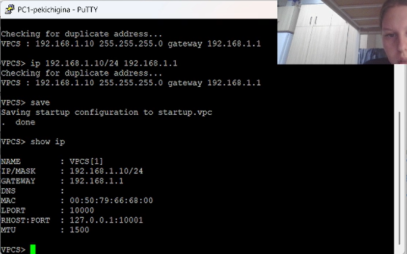

---
## Front matter
lang: ru-RU
title: Лабораторная работа №2
author:
  - Кичигина Полина Евгеньевна
institute:
  - Российский университет дружбы народов, Москва, Россия
date: 26 сентября 2026

## i18n babel
babel-lang: russian
babel-otherlangs: english

## Formatting pdf
toc: false
toc-title: Содержание
slide_level: 2
aspectratio: 169
section-titles: true
theme: metropolis
header-includes:
 - \metroset{progressbar=frametitle,sectionpage=progressbar,numbering=fraction}
---

## Цель работы

Построение простейших моделей сети на базе коммутатора и маршрутизаторов FRR и VyOS в GNS3, анализ трафика посредством Wireshark.

## Выполнение. Моделирование простейшей сети на базе коммутатора в GNS3

1. Построить в GNS3 топологию сети, состоящей из коммутатора Ethernet и двух
оконечных устройств (персональных компьютеров).
2. Задать оконечным устройствам IP-адреса в сети 192.168.1.0/24. Проверить
связь.

{#fig:001 width=50%}

## Анализ трафика в GNS3 посредством Wireshark

1. С помощью Wireshark захватить и проанализировать ARP-сообщения.
2. С помощью Wireshark захватить и проанализировать ICMP-сообщения.

 

{#fig:002 width=60%}

## Моделирование простейшей сети на базе маршрутизатора FRR в GNS3

1. Построить в GNS3 топологию сети, состоящей из маршрутизатора FRR, ком-
мутатора Ethernet и оконечного устройства.
2. Задать оконечному устройству IP-адрес в сети 192.168.1.0/24.
3. Присвоить интерфейсу маршрутизатора адрес 192.168.1.1/24
4. Проверить связь.

{#fig:003 width=45%}

## Моделирование простейшей сети на базе маршрутизатора VyOS в GNS3

1. Построить в GNS3 топологию сети, состоящей из маршрутизатора VyOS, ком-
мутатора Ethernet и оконечного устройства.
2. Задать оконечному устройству IP-адрес в сети 192.168.1.0/24.
3. Присвоить интерфейсу маршрутизатора адрес 192.168.1.1/24
4. Проверить связь.

{#fig:004 width=40%}

## Вывод

Мы построили простейшие модели сети на базе коммутатора и маршрутизаторов FRR и VyOS в GNS3, анализ трафика посредством Wireshark.

## {.standout}

Спасибо за внимание!

