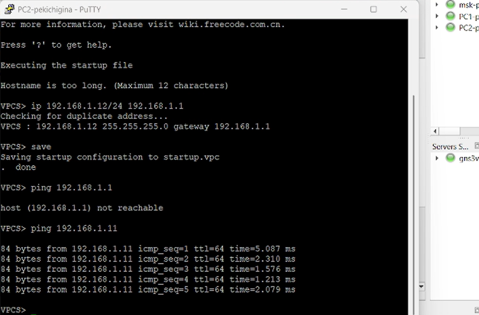
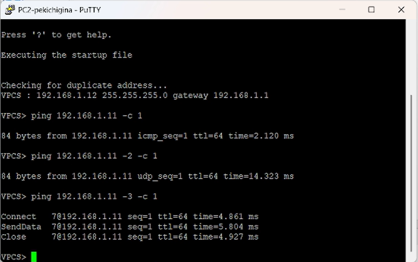
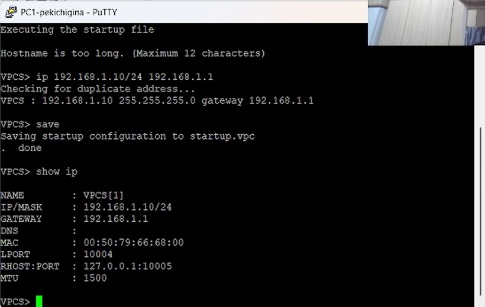

---
## Front matter
title: "Отчёт по лабораторной работе №2"
subtitle: "Отчёт"
author: "Кичигина Полина Евгеньевна"

## Generic otions
lang: ru-RU
toc-title: "Содержание"

## Bibliography
bibliography: bib/cite.bib
csl: pandoc/csl/gost-r-7-0-5-2008-numeric.csl

## Pdf output format
toc: true # Table of contents
toc-depth: 2
lof: true # List of figures
lot: true # List of tables
fontsize: 12pt
linestretch: 1.5
papersize: a4
documentclass: scrreprt
## I18n polyglossia
polyglossia-lang:
  name: russian
  options:
	- spelling=modern
	- babelshorthands=true
polyglossia-otherlangs:
  name: english
## I18n babel
babel-lang: russian
babel-otherlangs: english
## Fonts
mainfont: IBM Plex Serif
romanfont: IBM Plex Serif
sansfont: IBM Plex Sans
monofont: IBM Plex Mono
mathfont: STIX Two Math
mainfontoptions: Ligatures=Common,Ligatures=TeX,Scale=0.94
romanfontoptions: Ligatures=Common,Ligatures=TeX,Scale=0.94
sansfontoptions: Ligatures=Common,Ligatures=TeX,Scale=MatchLowercase,Scale=0.94
monofontoptions: Scale=MatchLowercase,Scale=0.94,FakeStretch=0.9
mathfontoptions:
## Biblatex
biblatex: true
biblio-style: "gost-numeric"
biblatexoptions:
  - parentracker=true
  - backend=biber
  - hyperref=auto
  - language=auto
  - autolang=other*
  - citestyle=gost-numeric
## Pandoc-crossref LaTeX customization
figureTitle: "Рис."
tableTitle: "Таблица"
listingTitle: "Листинг"
lofTitle: "Список иллюстраций"
lotTitle: "Список таблиц"
lolTitle: "Листинги"
## Misc options
indent: true
header-includes:
  - \usepackage{indentfirst}
  - \usepackage{float} # keep figures where there are in the text
  - \floatplacement{figure}{H} # keep figures where there are in the text
---

# Цель работы

Построение простейших моделей сети на базе коммутатора и маршрутизаторов FRR и VyOS в GNS3, анализ трафика посредством Wireshark.

# Выполнение

Моделирование простейшей сети на базе
коммутатора в GNS3

Постановка задачи

1. Построить в GNS3 топологию сети, состоящей из коммутатора Ethernet и двух
оконечных устройств (персональных компьютеров).
2. Задать оконечным устройствам IP-адреса в сети 192.168.1.0/24. Проверить
связь.

Порядок выполнения работы

1. Запустите GNS3 VM и GNS3. Создайте новый проект, назовите его, например,
pr-gns-01.
2. В рабочей области GNS3 разместите коммутатор Ethernet и два VPCS. Щёлкнув
на устройстве правой кнопкой мыши выберете в меню Configure . Измените
название устройства, включив в имя устройства имя учётной записи выполня-
ющего работу студента. Коммутатору присвойте название msk-user-sw-01,
где вместо user укажите имя вашей учётной записи. Соедините VPCS с ком-
мутатором. Отобразите обозначение интерфейсов соединения (рис. 2.1).
Рис. 2.1. Топология простейшей сети в GNS3
3. Задайте IP-адреса VPCS. Для этого с помощью меню, вызываемого правой
кнопкой мыши, запустите Start , например, PC-1, затем вызовите его терми-
нал Console . Для просмотра синтаксиса возможных для ввода команд набери-
те /? 
Рис. 2.2. Просмотр синтаксиса возможных для ввода команд VPCS в GNS3
30 Лабораторная работа № 2. Простые сети в GNS3. Анализ трафика
Для задания IP-адреса 192.168.1.11 в сети 192.168.1.0/24 введите 
ip 192.168.1.11/24 192.168.1.1
Здесь 192.168.1.1 — адрес шлюза. Для уточнения синтаксиса перед вводом
можно ввести ip /?. Для сохранения конфигурации необходимо ввести ко-
манду save.
Рис. 2.3. Задание IP-адреса и сохранение конфигурации VPCS в GNS3
Аналогичным образом задайте IP-адрес 192.168.1.12 для PC-2.
4. Проверьте работоспособность соединения между PC-1 и PC-2 с помощью
команды ping.
5. Остановите в проекте все узлы (меню GNS3 Control Stop all nodes ).(рис. [-@fig:001])

{#fig:001 width=70%}

Анализ трафика в GNS3 посредством Wireshark

Постановка задачи

1. С помощью Wireshark захватить и проанализировать ARP-сообщения.
2. С помощью Wireshark захватить и проанализировать ICMP-сообщения.

 Порядок выполнения работы
 
1. Запустите на соединении между PC-1 и коммутатором анализатор трафи-
ка. Для этого щёлкните правой кнопкой мыши на соединении, выберете
в меню Start capture , при необходимости можете скорректировать название
DUMP-файла. Запустится Wireshark, а в проекте GNS3 на соединении появится
значок лупы.
2. В проекте GNS3 стартуйте все узлы (меню GNS3 Control Start/Resume all nodes ).
В окне Wireshark отобразится информация по протоколу ARP. Про-
анализируйте полученную информацию, дайте пояснения в отчёте.
3. В терминале PC-2 посмотрите информацию по опциям команды ping, введя
ping /?. Затем сделайте один эхо-запрос в ICMP-моде к узлу PC-1. В окне
Wireshark (рис. 2.4) проанализируйте полученную информацию, дайте пояс-
нения в отчёте.
4. Сделайте один эхо-запрос в UDP-моде к узлу PC-1. В окне Wireshark 
проанализируйте полученную информацию, дайте пояснения в отчёте.
Королькова А. В., Кулябов Д. С. Сетевые технологии. Лабораторный практикум 31
Рис. 2.4. Полученная в Wireshark информация по ARP- и ICMP-сообщениям
5. Сделайте один эхо-запрос в TCP-моде к узлу PC-1. В окне Wireshark 
проанализируйте полученную информацию, дайте пояснения в отчёте.
6. Остановите захват пакетов в Wireshark.(рис. [-@fig:002])

{#fig:002 width=70%}

Моделирование простейшей сети на базе
маршрутизатора FRR в GNS3

Постановка задачи

1. Построить в GNS3 топологию сети, состоящей из маршрутизатора FRR, ком-
мутатора Ethernet и оконечного устройства.
2. Задать оконечному устройству IP-адрес в сети 192.168.1.0/24.
3. Присвоить интерфейсу маршрутизатора адрес 192.168.1.1/24
4. Проверить связь.

Порядок выполнения работы

1. Запустите GNS3 VM и GNS3. Создайте новый проект.
32 Лабораторная работа № 2. Простые сети в GNS3. Анализ трафика
2. В рабочей области GNS3 разместите VPCS, коммутатор Ethernet и маршрути-
затор FRR .
Рис. 2.5. Топология простейшей сети с маршрутизатором в GNS3
3. Измените отображаемые названия устройств. Коммутатору присвойте на-
звание по принципу msk-user-sw-0x, маршрутизатору — по принципу msk-
user-gw-0x, VPCS — по принципу PCx-user, где вместо user укажите имя
вашей учётной записи, вместо x — порядковый номер устройства.
4. Включите захват трафика на соединении между коммутатором и маршрути-
затором.
5. Запустите все устройства проекта. Откройте консоль всех устройств проекта.
6. Настройте IP-адресацию для интерфейса узла PC1:
ip 192.168.1.10/24 192.168.1.1
save
show ip
7. Настройте IP-адресацию для интерфейса локальной сети маршрутизатора:
Router# configure terminal
Router(config)# hostname msk-user-gw-01
msk-user-gw-01(config)# exit
msk-user-gw-01# write memory
msk-user-gw-01# configure terminal
msk-user-gw-01(config)# interface eth0
msk-user-gw-01(config-if)# ip address 192.168.1.1/24
msk-user-gw-01(config-if)# no shutdown
msk-user-gw-01(config-if)# exit
msk-user-gw-01(config)# exit
msk-user-gw-01# write memory
8. Проверьте конфигурацию маршрутизатора и настройки IP-адресации:
msk-user-gw-01# show running-config
msk-user-gw-01# show interface brief
9. Проверьте подключение. Узел PC1 должен успешно отправлять эхо-запросы
на адрес маршрутизатора 192.168.1.1.
10. В окне Wireshark проанализируйте полученную информацию, дайте поясне-
ния в отчёте.
11. Остановите захват пакетов в Wireshark. Остановите все устройства в проекте. (рис. [-@fig:003])

{#fig:003 width=70%}

Моделирование простейшей сети на базе
маршрутизатора VyOS в GNS3

Постановка задачи

1. Построить в GNS3 топологию сети, состоящей из маршрутизатора VyOS, ком-
мутатора Ethernet и оконечного устройства.
2. Задать оконечному устройству IP-адрес в сети 192.168.1.0/24.
3. Присвоить интерфейсу маршрутизатора адрес 192.168.1.1/24
4. Проверить связь.

Порядок выполнения работы

1. Запустите GNS3 VM и GNS3. Создайте новый проект.
2. В рабочей области GNS3 разместите VPCS, коммутатор Ethernet и маршрути-
затор VyOS 
3. Измените отображаемые названия устройств. Коммутатору присвойте на-
звание по принципу msk-user-sw-0x, маршрутизатору — по принципу msk-
user-gw-0x, VPCS — по принципу PCx-user, где вместо user укажите имя
вашей учётной записи, вместо x — порядковый номер устройства.
4. Включите захват трафика на соединении между коммутатором и маршрути-
затором.
5. Запустите все устройства проекта. Откройте консоль всех устройств проекта.
6. Настройте IP-адресацию для интерфейса узла PC1:
ip 192.168.1.10/24 192.168.1.1
save
show ip
7. Настройте маршрутизатор VyOS:
– После загрузки введите логин vyos и пароль vyos:
vyos login: vyos
Password:
– Перейдите в режим конфигурирования:
vyos@vyos$ configure
vyos@vyos#
34 Лабораторная работа № 2. Простые сети в GNS3. Анализ трафика
– Измените имя устройства (вместо user укажите свою учётную запись):
vyos@vyos#set system host-name msk-user-gw-01
Изменения в имени устройства вступят в силу после применения и сохра-
нения конфигурации и перезапуска устройства.
– Удалите указание на назначение ip-адреса по dhcp для интерфейса eth0:
vyos@vyos# del interfaces ethernet eth0 address dhcp
– Задайте IP-адрес на интерфейсе eth0:
vyos@vyos# set interfaces ethernet eth0 address
192.168.1.1/24↪
– Посмотрите внесённые в конфигурацию изменения:
vyos@vyos# compare
– Примените изменения в конфигурации и сохраните саму конфигурацию:
vyos@vyos# commit
vyos@vyos# save
– Посмотрите информацию об интерфейсах маршрутизатора:
vyos@vyos# show interfaces
– Выйдете из режима конфигурирования:
vyos@vyos# exit
vyos@vyos$
8. Проверьте подключение. Узел PC1 должен успешно отправлять эхо-запросы
на адрес маршрутизатора 192.168.1.1.
9. В окне Wireshark проанализируйте полученную информацию, дайте поясне-
ния в отчёте.
10. Остановите захват пакетов в Wireshark. Остановите все устройства в проекте.
Завершите работу с GNS3.(рис. [-@fig:004])

{#fig:004 width=70%}

# Вывод

Мы построили простейшие модели сети на базе коммутатора и маршрутизаторов FRR и VyOS в GNS3, анализ трафика посредством Wireshark.
