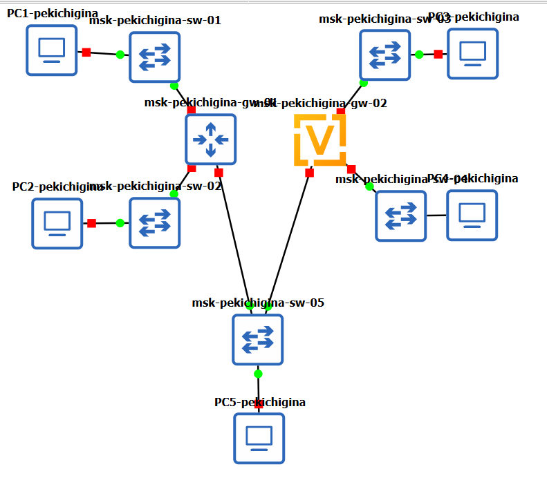
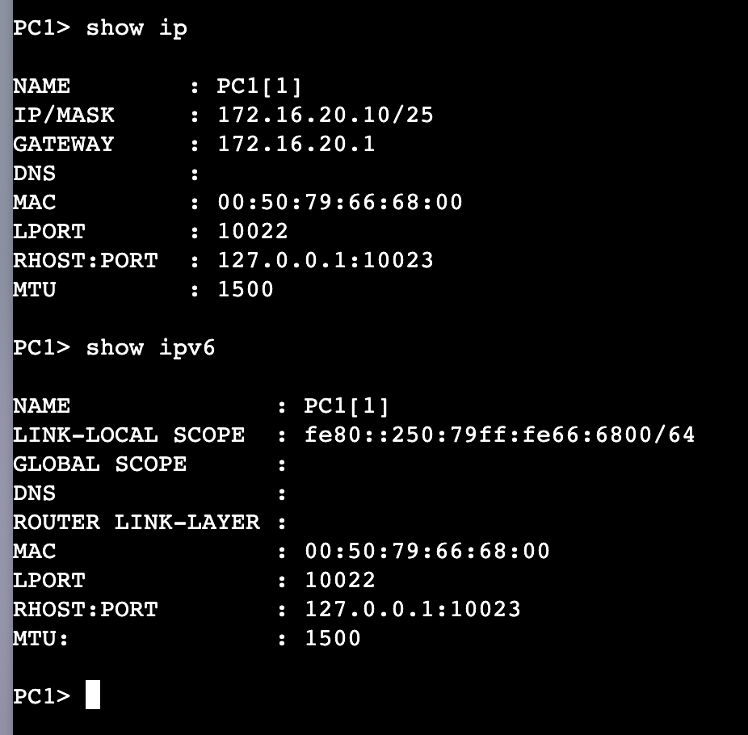
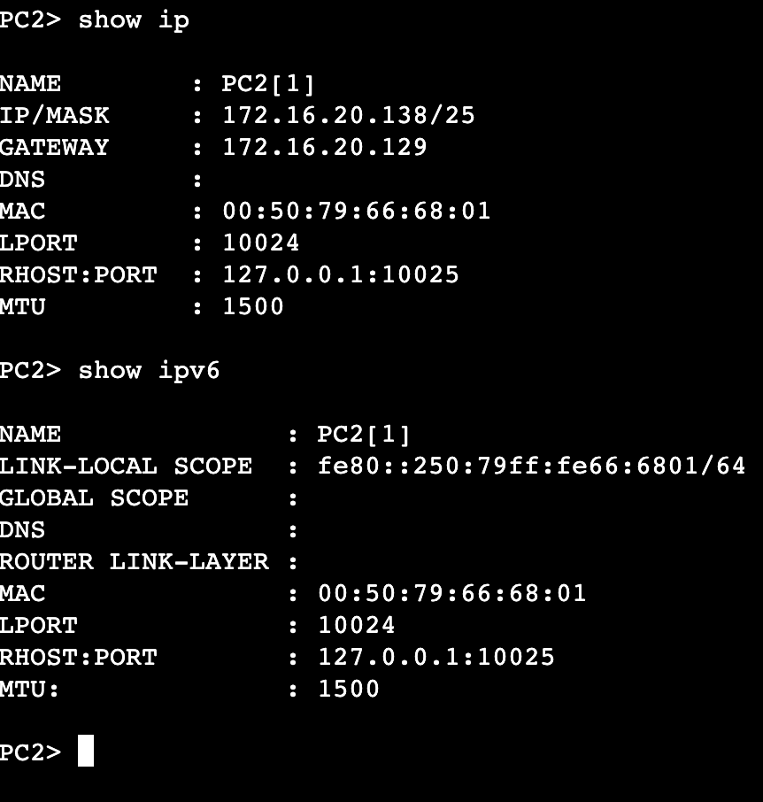
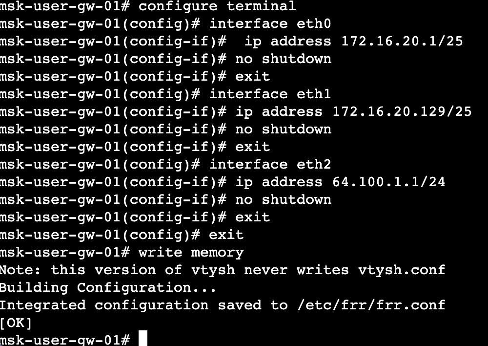
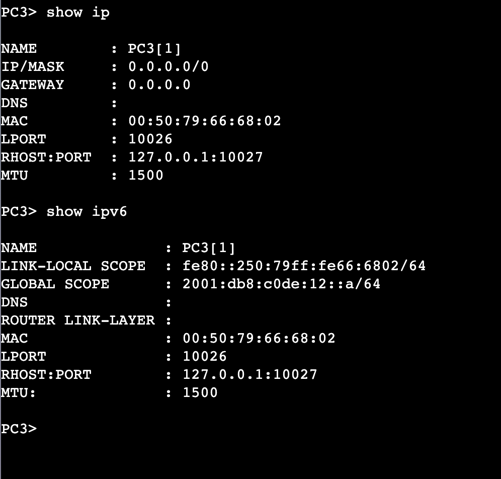
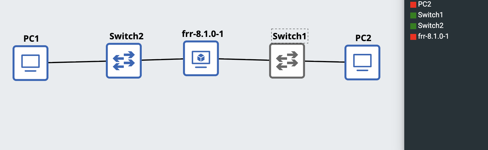
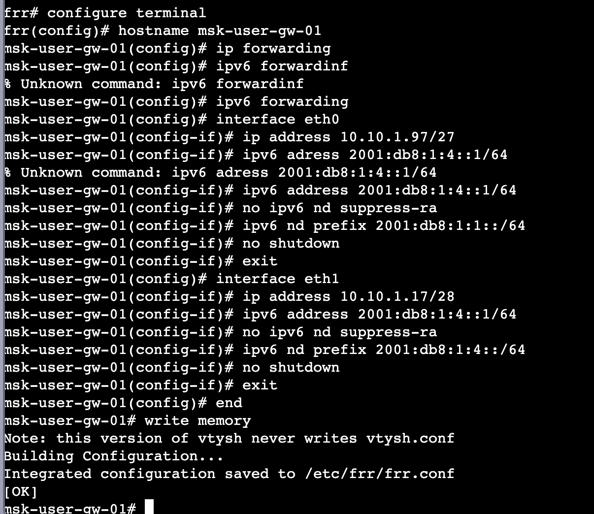

---
## Front matter
lang: ru-RU
title: Лабораторная работа №4
author:
  - Кичигина Полина Евгеньевна
institute:
  - Российский университет дружбы народов, Москва, Россия
date: 24 октября  2026

## i18n babel
babel-lang: russian
babel-otherlangs: english

## Formatting pdf
toc: false
toc-title: Содержание
slide_level: 2
aspectratio: 169
section-titles: true
theme: metropolis
header-includes:
 - \metroset{progressbar=frametitle,sectionpage=progressbar,numbering=fraction}
---

## Цель работы

Изучение принципов распределения и настройки адресного пространства на
устройствах сети.

## Выполнение лабораторной работы

Запустите GNS3 VM и GNS3. Создайте новый проект.

{#fig:001 width=50%}

## 

Руководствуясь табл. 4.1, настройте IPv4-адресацию для интерфейсов узлов. Посмотрите на PC1 

{#fig:002 width=50%}

##

и PC2 конфигурацию IPv4 и IPv6.

{#fig:003 width=50%}

##

Руководствуясь табл. 4.1, настройте IPv4-адресацию для интерфейсов локальной сети маршрутизатора FRR msk-user-gw-01.

{#fig:004 width=60%}

##

7. Проверьте конфигурацию маршрутизатора и настройки IPv4-адресации. Руководствуясь табл. 4.1, настройте IPv6-адресацию для интерфейсов узлов
PC3, PC4, Server.

{#fig:005 width=50%}

## Задание для самостоятельного выполнения

Задана топология сети (рис. 4.2).
Предполагается, что маршрутизатор разбивает сеть на две подсети с адресами
IPv4 и IPv6:

– подсеть 1: 10.10.1.96/27; 2001:DB8:1:1::/64;

– подсеть 2: 10.10.1.16/28; 2001:DB8:1:4::/64.

{#fig:006 width=70%}

## Требуется:

1. Охарактеризовать подсети, указать, какие адреса в них входят.
2. Предложить вариант таблицы адресации для заданной топологии и адресного
пространства, причём для интерфейсов маршрутизатора выбрать наимень-
ший адрес в подсети.

| Устройство    | Интерфейс | IPv4-адрес   | IPv6-адрес           | Шлюз по умолчанию |
|---------------|-----------|--------------|----------------------|-------------------|
| msk-user-gw-01| eth0      | 10.10.1.97/27| 2001:db8:1:1::1/64   | —                 |
| msk-user-gw-01| eth1      | 10.10.1.17/28| 2001:db8:1:4::1/64   | —                 |
| PC1-user      | NIC       | 10.10.1.98/27| 2001:db8:1:1::a/64   | 10.10.1.97        |
| PC2-user      | NIC       | 10.10.1.18/28| 2001:db8:1:4::a/64   | 10.10.1.17        |

##

3. Настроить IP-адресацию на маршрутизаторе VyOS и оконечных устройствах,
причём на интерфейсах маршрутизатора установить наименьший адрес
в подсети.
4. Проверить подключение между устройствами подсети с помощью команд
ping и trace.

{#fig:007 width=50%}

## Выводы

Мы изучили принципы распределения и настройки адресного пространства на
устройствах сети.
