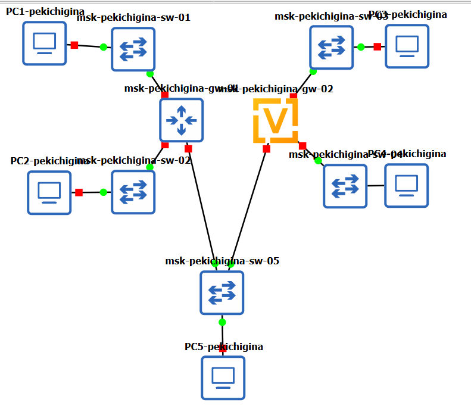
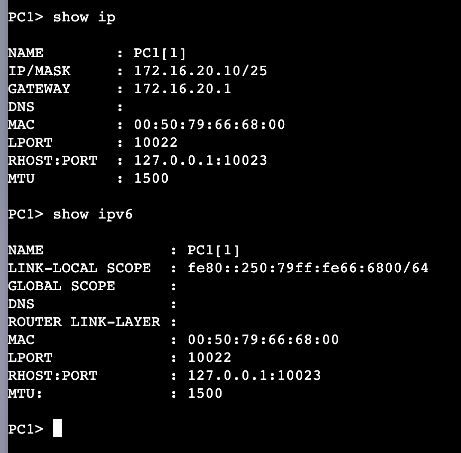
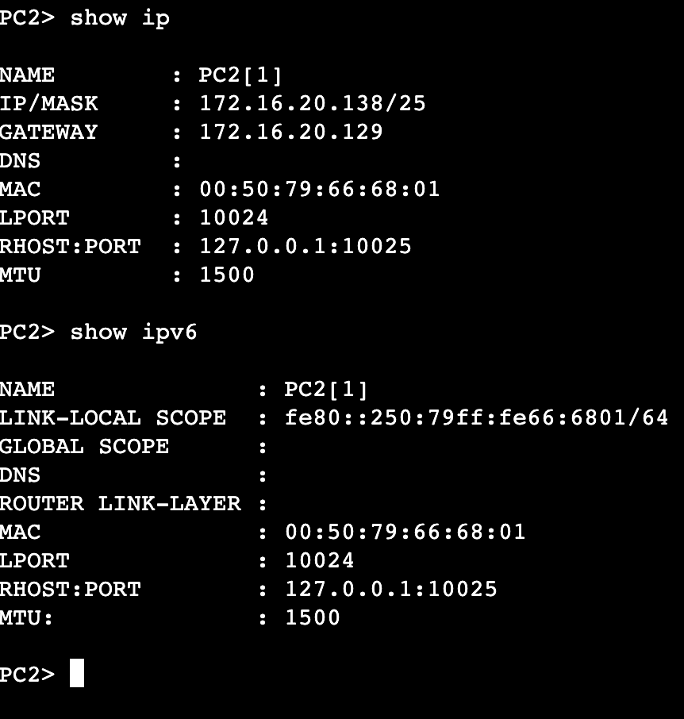
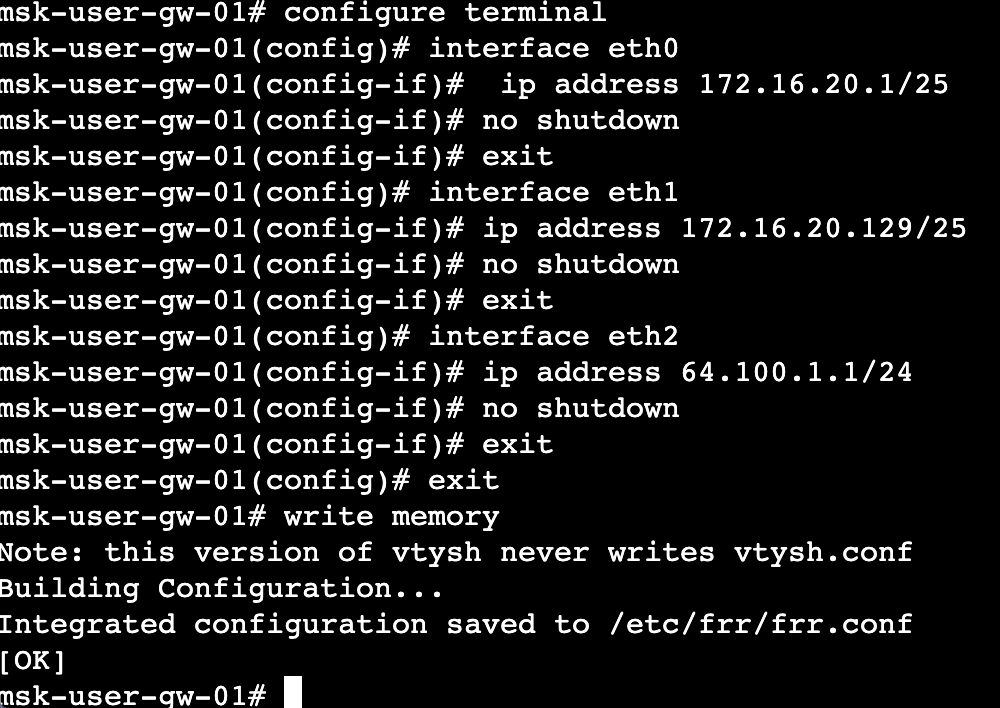
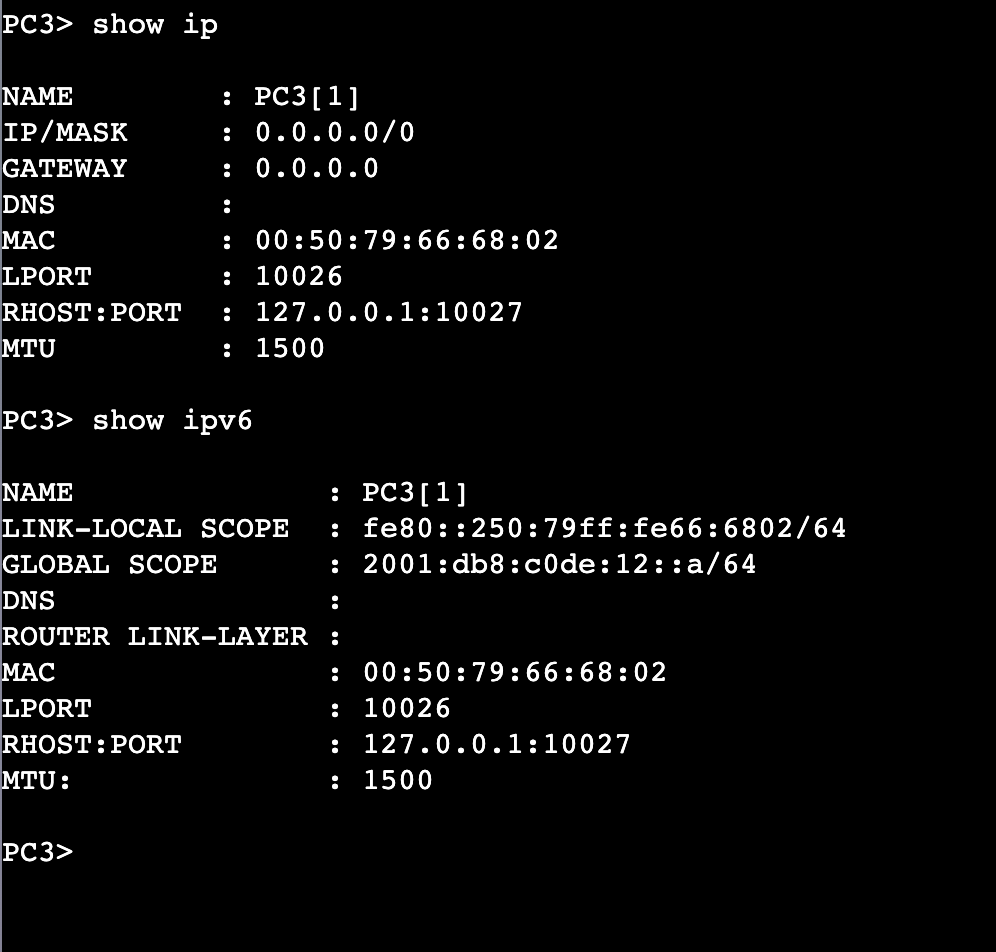
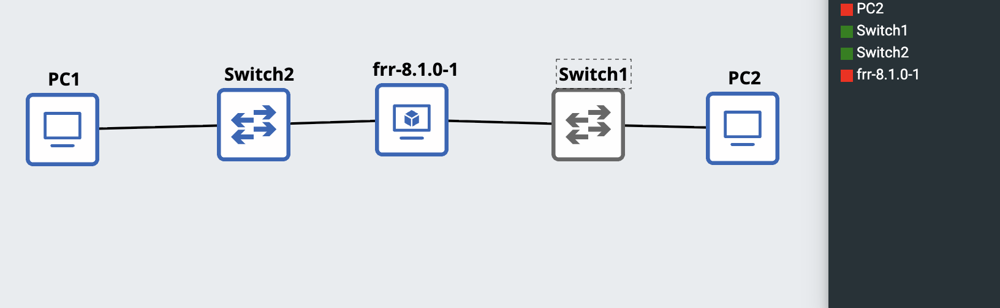
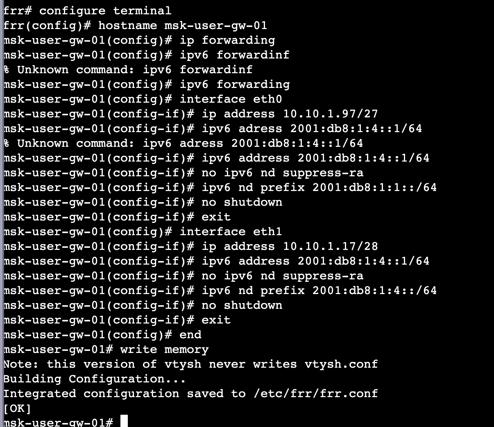

---
## Front matter
title: "Отчёт по лабораторной работе №4"
subtitle: "Отчет"
author: "Кичигина Полина Евгеньевна"

## Generic otions
lang: ru-RU
toc-title: "Содержание"

## Bibliography
bibliography: bib/cite.bib
csl: pandoc/csl/gost-r-7-0-5-2008-numeric.csl

## Pdf output format
toc: true # Table of contents
toc-depth: 2
lof: true # List of figures
lot: true # List of tables
fontsize: 12pt
linestretch: 1.5
papersize: a4
documentclass: scrreprt
## I18n polyglossia
polyglossia-lang:
  name: russian
  options:
	- spelling=modern
	- babelshorthands=true
polyglossia-otherlangs:
  name: english
## I18n babel
babel-lang: russian
babel-otherlangs: english
## Fonts
mainfont: IBM Plex Serif
romanfont: IBM Plex Serif
sansfont: IBM Plex Sans
monofont: IBM Plex Mono
mathfont: STIX Two Math
mainfontoptions: Ligatures=Common,Ligatures=TeX,Scale=0.94
romanfontoptions: Ligatures=Common,Ligatures=TeX,Scale=0.94
sansfontoptions: Ligatures=Common,Ligatures=TeX,Scale=MatchLowercase,Scale=0.94
monofontoptions: Scale=MatchLowercase,Scale=0.94,FakeStretch=0.9
mathfontoptions:
## Biblatex
biblatex: true
biblio-style: "gost-numeric"
biblatexoptions:
  - parentracker=true
  - backend=biber
  - hyperref=auto
  - language=auto
  - autolang=other*
  - citestyle=gost-numeric
## Pandoc-crossref LaTeX customization
figureTitle: "Рис."
tableTitle: "Таблица"
listingTitle: "Листинг"
lofTitle: "Список иллюстраций"
lotTitle: "Список таблиц"
lolTitle: "Листинги"
## Misc options
indent: true
header-includes:
  - \usepackage{indentfirst}
  - \usepackage{float} # keep figures where there are in the text
  - \floatplacement{figure}{H} # keep figures where there are in the text
---

# Цель работы

Изучение принципов распределения и настройки адресного пространства на
устройствах сети.

# Выполнение лабораторной работы

1. Запустите GNS3 VM и GNS3. Создайте новый проект.
2. В рабочем пространстве разместите и соедините устройства в соответствии
с топологией, приведённой на рис. 4.1. Для подсети IPv4 используйте марш-
рутизатор FRR, а для подсети с IPv6 — маршрутизатор VyOS.
3. Измените отображаемые названия устройств. Коммутаторам присвойте на-
звания по принципу msk-user-sw-0x, маршрутизаторам — по принципу
46 Лабораторная работа № 4. Адресация IPv4 и IPv6. Двойной стек
msk-user-gw-0x, VPCS — по принципу PCx-user, где вместо user укажите
имя вашей учётной записи, вместо x — порядковый номер устройства.
4. Включите захват трафика на соединении между сервером двойного стека
адресации и ближайшим к нему коммутатором.(рис. [-@fig:001])

{#fig:001 width=70%}

5. Руководствуясь табл. 4.1, настройте IPv4-адресацию для интерфейсов узлов
PC1, PC2, Server:
– PC1:
ip 172.16.20.10/25 172.16.20.1
save
– PC2:
ip 172.16.20.138/25 172.16.20.129
save
– Server:
ip 64.100.1.10/24 64.100.1.1
save
– Посмотрите на PC1 и PC2(рис. [-@fig:003]) конфигурацию IPv4 и IPv6:
show ip
show ipv6(рис. [-@fig:002])

{#fig:002 width=70%}

{#fig:003 width=70%}

6. Руководствуясь табл. 4.1, настройте IPv4-адресацию для интерфейсов локаль-
ной сети маршрутизатора FRR msk-user-gw-01.(рис. [-@fig:004])

{#fig:004 width=70%}

7. Проверьте конфигурацию маршрутизатора и настройки IPv4-адресации:
msk-user-gw-01# show running-config
msk-user-gw-01# show interface brief
Королькова А. В., Кулябов Д. С. Сетевые технологии. Лабораторный практикум 47
8. Проверьте подключение с помощью команд ping и trace. Узлы PC1 и PC2
должны успешно отправлять эхо-запросы друг другу и на сервер с двойным
стеком (Dual Stack Server).
9. Руководствуясь табл. 4.1, настройте IPv6-адресацию для интерфейсов узлов
PC3, PC4, Server:
– PC3:
ip 2001:db8:c0de:12::a/64
save
– PC4:
ip 2001:db8:c0de:13::a/64
save
– Server:
ip 2001:db8:c0de:11::a/64
save
10. Посмотрите на PC3 и PC4 конфигурацию IPv4 и IPv6:
show ip
show ipv6(рис. [-@fig:005])

{#fig:005 width=70%}

11. Руководствуясь табл. 4.1, настройте IPv6-адресацию для интерфейсов локаль-
ной сети маршрутизатора VyOS msk-user-gw-02:
– Перейдите в режим конфигурирования, измените имя устройства и удали-
те указание на назначение ip-адреса по dhcp для интерфейса eth0.
– Назначьте IPv6-адреса маршрутизатору msk-user-gw-02.
12. Проверьте подключение с помощью команд ping и trace. Узлы PC3 и PC4
должны успешно отправлять эхо-запросы друг другу и на сервер с двойным
стеком (Dual Stack Server).
13. Убедитесь, что устройства из подсети IPv4 не доступны для устройств из
подсети IPv6 и наоборот. Только сервер двойного стека может обращаться
к устройствам обеих подсетей.
14. Посмотрите захваченный на соединении сервера двойного стека адресации
с коммутатором трафик ARP, ICMP, ICMPv6. В отчёте поясните, какую инфор-
мацию можно извлечь из перехваченных пакетов.

#Задание для самостоятельного выполнения

Задана топология сети (рис. 4.2).
Предполагается, что маршрутизатор разбивает сеть на две подсети с адресами
IPv4 и IPv6:
– подсеть 1: 10.10.1.96/27; 2001:DB8:1:1::/64;
– подсеть 2: 10.10.1.16/28; 2001:DB8:1:4::/64.(рис. [-@fig:006])

{#fig:006 width=70%}

Требуется:
1. Охарактеризовать подсети, указать, какие адреса в них входят.
2. Предложить вариант таблицы адресации для заданной топологии и адресного
пространства, причём для интерфейсов маршрутизатора выбрать наимень-
ший адрес в подсети.

| Устройство    | Интерфейс | IPv4-адрес   | IPv6-адрес           | Шлюз по умолчанию |
|---------------|-----------|--------------|----------------------|-------------------|
| msk-user-gw-01| eth0      | 10.10.1.97/27| 2001:db8:1:1::1/64   | —                 |
| msk-user-gw-01| eth1      | 10.10.1.17/28| 2001:db8:1:4::1/64   | —                 |
| PC1-user      | NIC       | 10.10.1.98/27| 2001:db8:1:1::a/64   | 10.10.1.97        |
| PC2-user      | NIC       | 10.10.1.18/28| 2001:db8:1:4::a/64   | 10.10.1.17        |

3. Настроить IP-адресацию на маршрутизаторе VyOS и оконечных устройствах,
причём на интерфейсах маршрутизатора установить наименьший адрес
в подсети.
4. Проверить подключение между устройствами подсети с помощью команд
ping и trace.(рис. [-@fig:007])

{#fig:007 width=70%}

# Выводы

Мы изучили принципы распределения и настройки адресного пространства на
устройствах сети.

