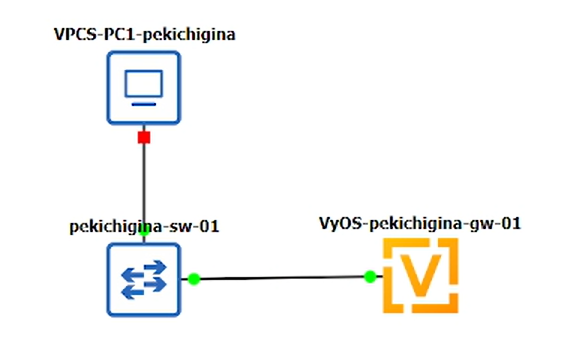
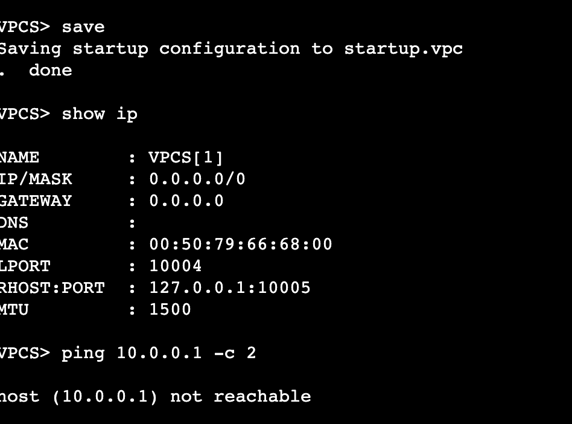
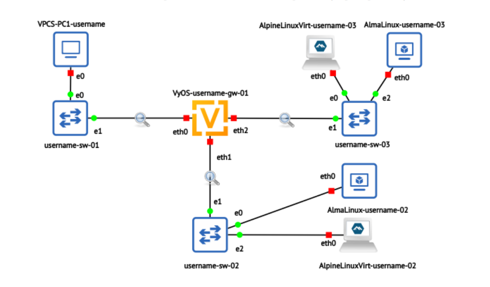
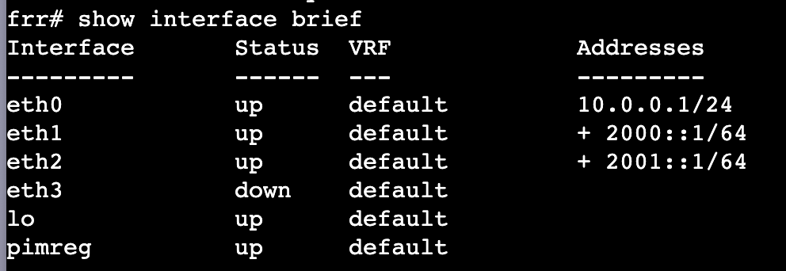
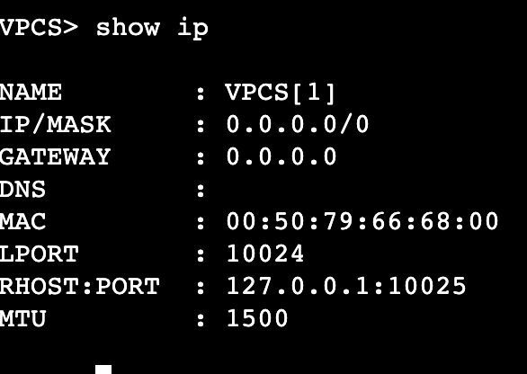

---
## Front matter
lang: ru-RU
title: Лабораторная работа №5
author:
  - Кичигина Полина Евгеньевна
institute:
  - Российский университет дружбы народов, Москва, Россия
date: 18 апреля 2026

## i18n babel
babel-lang: russian
babel-otherlangs: english

## Formatting pdf
toc: false
toc-title: Содержание
slide_level: 2
aspectratio: 169
section-titles: true
theme: metropolis
header-includes:
 - \metroset{progressbar=frametitle,sectionpage=progressbar,numbering=fraction}
---

## Цель работы

Получение навыков настройки службы DHCP на сетевом оборудовании для
распределения адресов IPv4 и IPv6.

## Выполнение лабораторной работы

 В GNS3 была построена сеть, состоящая из маршрутизатора VyOS, коммутатора и виртуального ПК (VPCS). Данная схема используется для демонстрации работы протокола DHCP в сети IPv4.

{#fig:001 width=50%}

##

На маршрутизаторе были сконфигурированы IPv4- и IPv6-адреса. Команда show interface brief подтверждает, что интерфейсу eth0 присвоен шлюз 10.0.0.1/24, а интерфейсам eth1 и eth2 — IPv6-адреса (2000::1/64 и 2001::1/64).

{#fig:002 width=50%}

## 

Для второй части лабораторной работы сеть была расширена. В нее добавлены хосты AlmaLinux и AlpineLinux, так как стандартный клиент VPCS не поддерживает динамическую настройку адресов по протоколу DHCPv6.

{#fig:003 width=70%}

##

Для добавления Linux-хостов в GNS3 был использован шаблон Docker-контейнера (на примере образа alpine:latest). Это позволило развернуть необходимые виртуальные машины для проверки работы протокола DHCPv6.

{#fig:004 width=70%}

##

На маршрутизаторе была запущена служба DHCP. Проверка системных процессов подтверждает, что демон dnsmasq (отвечающий за выдачу адресов) успешно запущен и функционирует.

{#fig:005 width=50%}

## Выводы

Мы получили навыки настройки службы DHCP на сетевом оборудовании для
распределения адресов IPv4 и IPv6.

## {.standout}

Спасибо за внимание!
