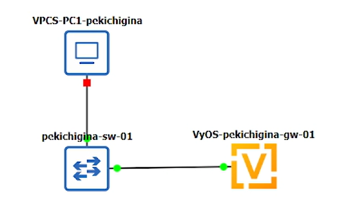
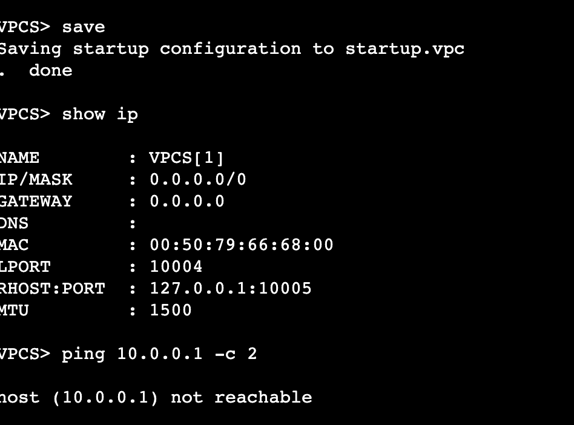
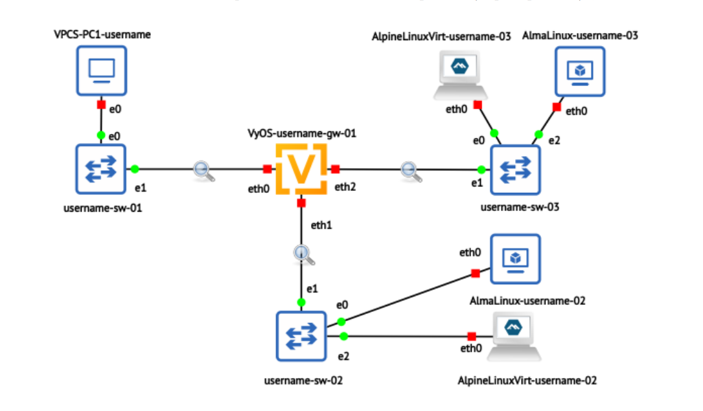
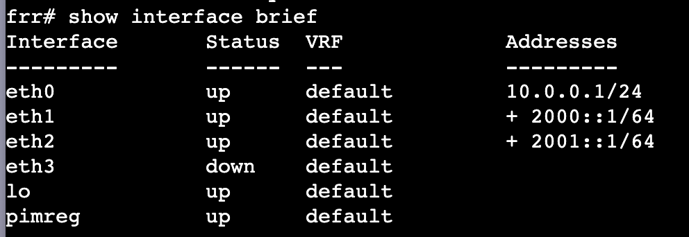
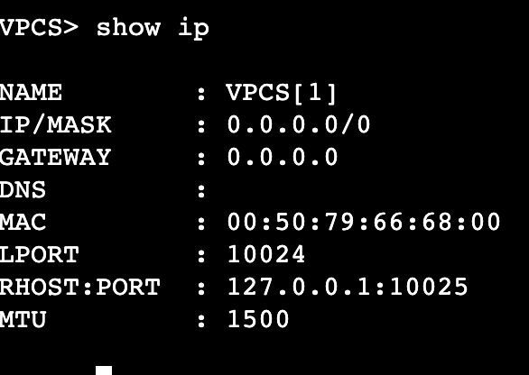

---
## Front matter
title: "Отчёт по лабораторной работе №5"
subtitle: "Отчет"
author: "Кичигина Полина Евгеньевна"

## Generic otions
lang: ru-RU
toc-title: "Содержание"

## Bibliography
bibliography: bib/cite.bib
csl: pandoc/csl/gost-r-7-0-5-2008-numeric.csl

## Pdf output format
toc: true # Table of contents
toc-depth: 2
lof: true # List of figures
lot: true # List of tables
fontsize: 12pt
linestretch: 1.5
papersize: a4
documentclass: scrreprt
## I18n polyglossia
polyglossia-lang:
  name: russian
  options:
	- spelling=modern
	- babelshorthands=true
polyglossia-otherlangs:
  name: english
## I18n babel
babel-lang: russian
babel-otherlangs: english
## Fonts
mainfont: IBM Plex Serif
romanfont: IBM Plex Serif
sansfont: IBM Plex Sans
monofont: IBM Plex Mono
mathfont: STIX Two Math
mainfontoptions: Ligatures=Common,Ligatures=TeX,Scale=0.94
romanfontoptions: Ligatures=Common,Ligatures=TeX,Scale=0.94
sansfontoptions: Ligatures=Common,Ligatures=TeX,Scale=MatchLowercase,Scale=0.94
monofontoptions: Scale=MatchLowercase,Scale=0.94,FakeStretch=0.9
mathfontoptions:
## Biblatex
biblatex: true
biblio-style: "gost-numeric"
biblatexoptions:
  - parentracker=true
  - backend=biber
  - hyperref=auto
  - language=auto
  - autolang=other*
  - citestyle=gost-numeric
## Pandoc-crossref LaTeX customization
figureTitle: "Рис."
tableTitle: "Таблица"
listingTitle: "Листинг"
lofTitle: "Список иллюстраций"
lotTitle: "Список таблиц"
lolTitle: "Листинги"
## Misc options
indent: true
header-includes:
  - \usepackage{indentfirst}
  - \usepackage{float} # keep figures where there are in the text
  - \floatplacement{figure}{H} # keep figures where there are in the text
---

# Цель работы

Получение навыков настройки службы DHCP на сетевом оборудовании для
распределения адресов IPv4 и IPv6.

# Выполнение лабораторной работы

1. Запустите GNS3 VM и GNS3. Создайте новый проект, назовите его, например,
pr-gns3-dhcp.
2. В рабочем пространстве разместите и соедините устройства в соответствии
с топологией, приведённой на рис. 5.1. Используйте маршрутизатор VyOS
и хост (клиент) VPCS.
3. Измените отображаемые названия устройств. Коммутаторам присвойте на-
звания по принципу username-sw-0x, маршрутизаторам — по принципу
username-gw-0x, VPCS — по принципу PCx-username, где вместо username
укажите имя вашей учётной записи, вместо x — порядковый номер устрой-
ства.(рис. [-@fig:001])

{#fig:001 width=70%}

4. Включите захват трафика на соединении между коммутатором sw-01 и марш-
рутизатором gw-01.
– На маршрутизаторе перейдите в режим конфигурирования, измените имя
устройства и доменное имя, замените системного пользователя, заданного
по умолчанию, на вашего пользователя (вместо username укажите имя
вашей учётной записи, вместо <mysecurepassword> — пароль для доступа
Королькова А. В., Кулябов Д. С. Сетевые технологии. Лабораторный практикум 53
к устройству, например 123456 или любой другой), удалите указание на
назначение ip-адреса по dhcp для интерфейса eth0.
5. На маршрутизаторе под созданным пользователем перейдите в режим кон-
фигурирования и настройте адресацию IPv4:
username@username-gw-01# set interfaces ethernet eth0
address 10.0.0.1/24↪
6. Добавьте конфигурацию DHCP-сервера на маршрутизаторе (вместо username
укажите имя вашей учётной записи):
.
Здесь при помощи указанных выше команд была создана разделяемая сеть
(shared-network-name) с названием username, подсеть (subnet) с адресом
10.0.0.0/24, задан диапазон адресов (range) с именем hosts, содержащий
адреса 10.0.0.2–10.0.0.253.
7. Для просмотра статистики DHCP-сервера и выданных адресов используйте
команды:
username@username-gw-01$ show dhcp server statistics
54 Лабораторная работа № 5. Адресация IPv4 и IPv6. Настройка DHCP
username@username-gw-01$ show dhcp server leases
8. Настройте оконечное устройство PC1:
PC1-username> ip dhcp -d
PC1-username> save
Здесь использована опция -d для обеспечения возможности просмотра деко-
дированных запросов DHCP. В отчёте поясните полученную на экране PC1
информацию.
9. Проверьте конфигурацию IPv4 на узле, пропингуйте маршрутизатор:
PC1-username> show ip
PC1-username> ping 10.0.0.1 -c 2
10. На маршрутизаторе вновь посмотрите статистику DHCP-сервера и выданные
адреса, в отчёте поясните полученную информацию:
username@username-gw-01$ show dhcp server statistics
username@username-gw-01$ show dhcp server leases
11. На маршрутизаторе посмотрите журнал работы DHCP-сервера:
username@username-gw-01$ show log | grep dhcp
 (рис. [-@fig:002])

{#fig:002 width=70%}

Порядок выполнения работы
1. В предыдущем проекте в рабочем пространстве дополните сеть, разместив
и соединив устройства в соответствии с топологией, приведённой на рис. 5.2.
Используйте хост (клиент) Alma Linux и Alpine Linux Virt appliance (добавьте
соответствующие образы в перечень устройств в GNS3), поскольку клиент
VPCS не поддерживает DHCPv6.
2. Измените отображаемые названия устройств. Коммутаторам присвойте на-
звания по принципу username-sw-0x, маршрутизаторам — по принципу
username-gw-0x, VPCS — по принципу PCx-username, где вместо username
укажите имя вашей учётной записи, вместо x — порядковый номер устрой-
ства.
3. Включите захват трафика на соединениях между маршрутизатором gw-01
и коммутаторами sw-02 и sw-03.(рис. [-@fig:003])

{#fig:003 width=70%}

4. Настройте адресацию IPv6 на маршрутизаторе:
username@username-gw-01:~$ configure
username@username-gw-01# set interfaces ethernet eth1
address 2000::1/64↪
username@username-gw-01# set interfaces ethernet eth2
address 2001::1/64↪
username@username-gw-01# show interfaces
username@username-gw-01# commit
56 Лабораторная работа № 5. Адресация IPv4 и IPv6. Настройка DHCP
username@username-gw-01# save(рис. [-@fig:004])

{#fig:004 width=70%}

5. На маршрутизаторе настройте DHCPv6 без отслеживания состояния (DHCPv6
Stateless configuration):
– Настройка объявления о маршрутизаторах (Router Advertisements, RA) на
интерфейсе eth1:
username@username-gw-01# set service router-advert
interface eth1 prefix 2000::/64↪
username@username-gw-01# set service router-advert
interface eth1 other-config-flag↪
Опция other-config-flag означает, что для конфигурации не адресных
параметров использует протокол с сохранением состояния.
– Добавление конфигурации DHCP-сервера (вместо username укажите имя
вашей учётной записи).
Здесь с помощью указанных выше команд создана разделяемая сеть (shared-
network-name) с названием username, задана информация общих оп-
ций (common-options) для разделяемой сети. При этом подсеть (subnet)
2000::/64 не требуется настраивать, поскольку она не будет содержать
полезной информации.
6. На узлах AlmaLinux и AlpineLinuxVirt PC2 проверьте настройки сети:
root@PC2-username:/# ip address
root@PC2-username:/# ip -6 route show
7. На узлах AlmaLinux и AlpineLinuxVirt PC2 пропингуйте маршрутизатор:
root@PC2-username:/# ping 2000::1 -c 2
8. На узлах AlmaLinux и AlpineLinuxVirt PC2 проверьте настройки DNS:
root@PC2-username:/# cat /etc/resolv.conf
9. На маршрутизаторе посмотрите, выдается ли статистика DHCP-сервера и вы-
данные адреса
username@username-gw-01# run show dhcpv6 server leases
10. В отчёте поясните выведенную на маршрутизаторе и PC2 информацию,
а также проанализируйте захваченные анализатором трафика пакеты, отно-
сящиеся к работе DHCPv6 и назначению адреса устройству.
11. На маршрутизаторе настройте DHCPv6 с отслеживанием состояния (DHCPv6
Stateful configuration):
Королькова А. В., Кулябов Д. С. Сетевые технологии. Лабораторный практикум 57
– На интерфейсе eth2 маршрутизатора настройте объявления о маршрути-
заторах (Router Advertisements, RA):
username@username-gw-01# set service router-advert
interface eth2 managed-flag
Опция managed-flag означает, что хосты использует администрируемый
(отслеживающий состояние) протокол для автоматической настройки ад-
ресов в дополнение к любым адресам, автоматически настраиваемым
с помощью SLAAC.
– Добавьте конфигурацию DHCP-сервера на маршрутизаторе (вместо username
укажите имя вашей учётной записи)
Здесь при помощи указанных выше команд создана разделяемая сеть
(shared-network-name) с названием username, подсеть (subnet) с адре-
сом 2001::/64, задан диапазон адресов (range) с именем hosts, содер-
жащий адреса 2001::100 – 2001::199.
12. На маршрутизаторе посмотрите статистику DHCP-сервера и выданные адре-
са:
username@username-gw-01# run show dhcpv6 server leases
13. Подключитесь к узлу PC3 и проверьте настройки сети:
root@PC3-username:/# ip address
root@PC3-username:/# ip -6 route show
14. На узлах AlmaLinux и AlpineLinuxVirt PC3 проверьте настройки DNS:
root@PC3-username:/# cat /etc/resolv.conf
15. На узле AlpineLinuxVirt PC3 получите адрес по DHCPv6:
root@PC3-username:/# udhcpc6 -i eth0
16. Вновь на узлах AlmaLinux и AlpineLinuxVirt PC3 проверьте настройки сети,
пропингуйте маршрутизатор, проверьте настройки DNS. (рис. [-@fig:005])

{#fig:005 width=70%}

# Выводы

Мы получили навыки настройки службы DHCP на сетевом оборудовании для
распределения адресов IPv4 и IPv6.
