---
## Front matter
lang: ru-RU
title: Лабораторная работа №6
author:
  - Кичигина Полина Евгеньевна
institute:
  - Российский университет дружбы народов, Москва, Россия
date: 2 мая 2026

## i18n babel
babel-lang: russian
babel-otherlangs: english

## Formatting pdf
toc: false
toc-title: Содержание
slide_level: 2
aspectratio: 169
section-titles: true
theme: metropolis
header-includes:
 - \metroset{progressbar=frametitle,sectionpage=progressbar,numbering=fraction}
---

## Цель работы

Изучение принципов маршрутизации по протоколу RIP в IPv4- и IPv6-сетях
и принципов настройки сетевого оборудования.

## Порядок выполнения работы. Топология моделируемой сети.

В рабочем пространстве разместите и соедините устройства в соответствии
с топологией, приведённой на рис. 6.1. Используйте маршрутизаторы FRR.
 Измените отображаемые названия устройств. 
 Включите захват трафика на соединении между коммутатором sw-01 и марш-
рутизатором gw-01, а также между коммутатором sw-02 и маршрутизатором
gw-03.

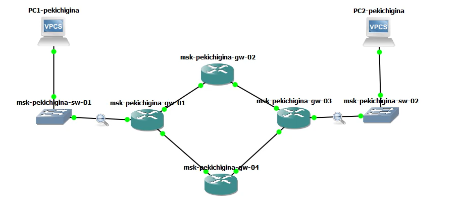{#fig:001 width=65%}

##

 Присвойте IPv4-адреса оконечным устройствам PC1 и PC2 в соответствии
с данными в табл. 6.2. 

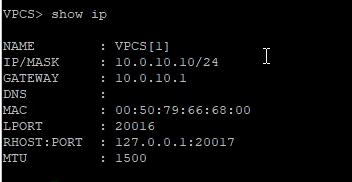{#fig:002 width=70%}

##

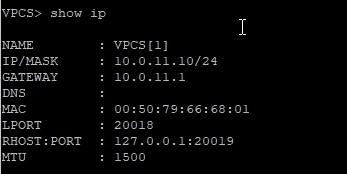{#fig:003 width=70%}

##

Настройте IPv4-адреса на интерфейсах маршрутизаторов:
msk-user-gw-01.

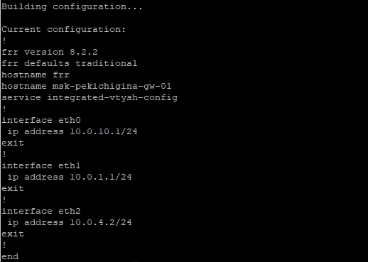{#fig:004 width=70%}

##

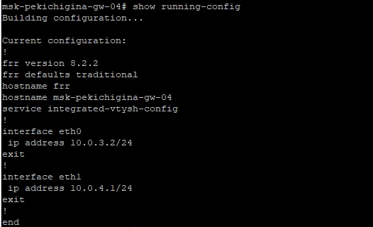{#fig:005 width=70%}

##

Присвойте IPv6-адреса оконечным устройствам PC1 и PC2 в соответствии
с данными в табл. 6.2.

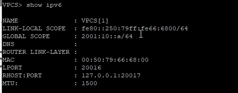{#fig:006 width=70%}

##

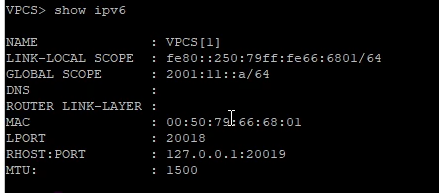{#fig:007 width=70%}

##

Настройте IPv6-адреса на интерфейсах маршрутизаторов:
msk-user-gw-01

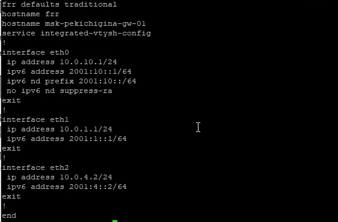{#fig:008 width=70%}

## Настройка динамической маршрутизации по протоколу RIP.

 На маршрутизаторах настройте RIP в качестве протокола динамической
маршрутизации.
Убедитесь, что маршрутизация по RIP настроена

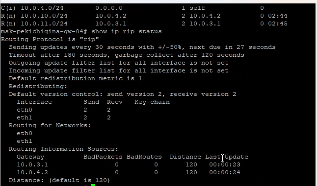{#fig:009 width=62%}

##

 Проверьте пути прохождения пакетов:
– С PC1 пропингуйте PC2 и определите путь следования пакетов.

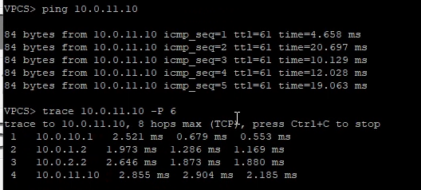{#fig:010 width=70%}

##

Проверьте метрики протокола RIPng:
msk-user-gw-01# show ipv6 ripng, С PC1 пропингуйте PC2 и определите путь следования пакетов.
Отметьте примерное время, за которое восстановится маршрут.
Включите на маршрутизаторе msk-user-gw-02 интерфейс.
С PC1 пропингуйте PC2 и определите путь следования пакетов

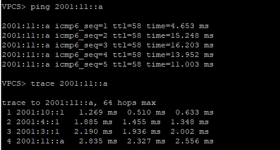{#fig:011 width=70%}

# Задание для самостоятельного выполнения

Топология сети 

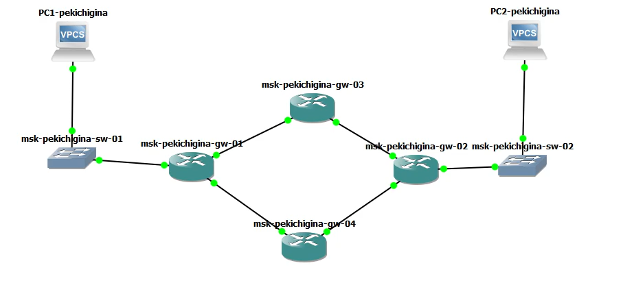{#fig:012 width=70%}

##

– настроить двойной стек IPv4 и IPv6, проверить соединения;

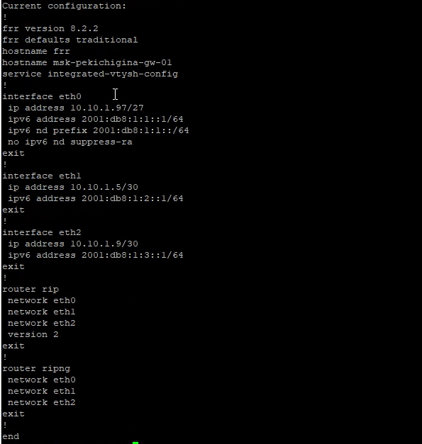{#fig:013 width=70%}

##

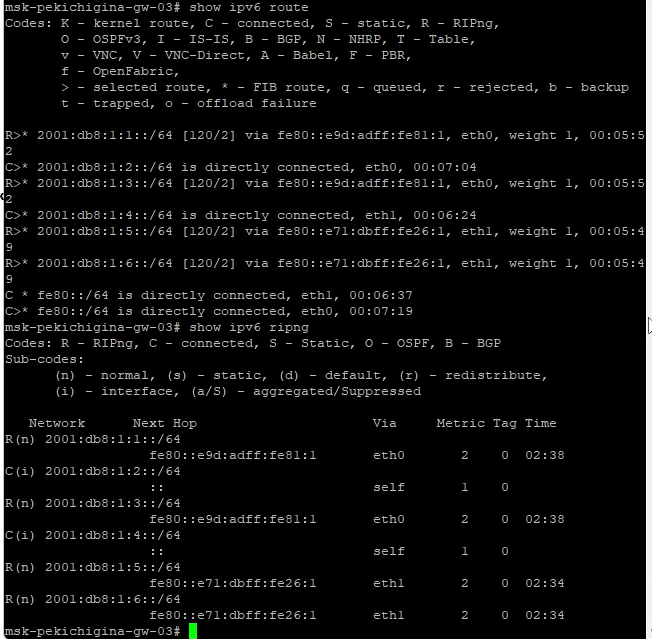{#fig:014 width=66%}

##

– настроить динамическую маршрутизацию сетей IPv4 и IPv6 для протокола
RIP, проверить соединения и маршруты.

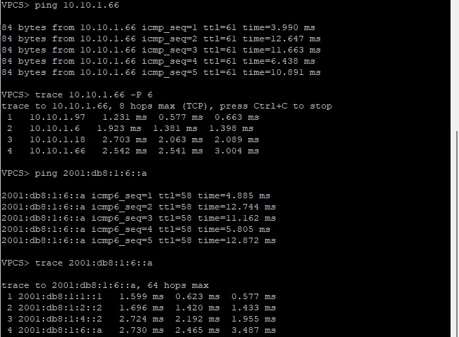{#fig:015 width=60%}

## Выводы

Мы изучили принципы маршрутизации по протоколу RIP в IPv4- и IPv6-сетях
и принципов настройки сетевого оборудования.

