---
## Front matter
title: "Отчет по Лабораторной работе №6"
subtitle: "Отчет"
author: "Кичигина Полина Евгеньевна"

## Generic otions
lang: ru-RU
toc-title: "Содержание"

## Bibliography
bibliography: bib/cite.bib
csl: pandoc/csl/gost-r-7-0-5-2008-numeric.csl

## Pdf output format
toc: true # Table of contents
toc-depth: 2
lof: true # List of figures
lot: true # List of tables
fontsize: 12pt
linestretch: 1.5
papersize: a4
documentclass: scrreprt
## I18n polyglossia
polyglossia-lang:
  name: russian
  options:
	- spelling=modern
	- babelshorthands=true
polyglossia-otherlangs:
  name: english
## I18n babel
babel-lang: russian
babel-otherlangs: english
## Fonts
mainfont: IBM Plex Serif
romanfont: IBM Plex Serif
sansfont: IBM Plex Sans
monofont: IBM Plex Mono
mathfont: STIX Two Math
mainfontoptions: Ligatures=Common,Ligatures=TeX,Scale=0.94
romanfontoptions: Ligatures=Common,Ligatures=TeX,Scale=0.94
sansfontoptions: Ligatures=Common,Ligatures=TeX,Scale=MatchLowercase,Scale=0.94
monofontoptions: Scale=MatchLowercase,Scale=0.94,FakeStretch=0.9
mathfontoptions:
## Biblatex
biblatex: true
biblio-style: "gost-numeric"
biblatexoptions:
  - parentracker=true
  - backend=biber
  - hyperref=auto
  - language=auto
  - autolang=other*
  - citestyle=gost-numeric
## Pandoc-crossref LaTeX customization
figureTitle: "Рис."
tableTitle: "Таблица"
listingTitle: "Листинг"
lofTitle: "Список иллюстраций"
lotTitle: "Список таблиц"
lolTitle: "Листинги"
## Misc options
indent: true
header-includes:
  - \usepackage{indentfirst}
  - \usepackage{float} # keep figures where there are in the text
  - \floatplacement{figure}{H} # keep figures where there are in the text
---

# Цель работы

Изучение принципов маршрутизации по протоколу RIP в IPv4- и IPv6-сетях
и принципов настройки сетевого оборудования.

# Порядок выполнения работы

Адреса сетей в табл. [-@tbl:std-dir]

: Таблица адресов сетей {#tbl:std-dir}

| Устройства | Сеть IPv4 | Сеть IPv6 |
|---|---|---|
| PC1 – gw-01 | 10.0.10.0/24 | 2001:10::/64 |
| PC2 – gw-03 | 10.0.11.0/24 | 2001:11::/64 |
| gw-01 – gw-02 | 10.0.1.0/24 | 2001:1::/64 |
| gw-02 – gw-03 | 10.0.2.0/24 | 2001:2::/64 |
| gw-03 – gw-04 | 10.0.3.0/24 | 2001:3::/64 |
| gw-04 – gw-01 | 10.0.4.0/24 | 2001:4::/64 |

Адресация[-@tbl:std-dir-2]

: Таблица адресации {#tbl:std-dir-2}

| Устройство | Интерфейс | Адрес IP/префикс | Шлюз по умолчанию | Следующее устройство |
|---|---|---|---|---|
| gw-01 | eth0 | 10.0.10.1/24 | n/a | PC1 |
| gw-01 | eth0 | 2001:10::1/64 | n/a | PC1 |
| gw-01 | eth1 | 10.0.1.1/24 | n/a | gw-02 |
| gw-01 | eth1 | 2001:1::1/64 | n/a | gw-02 |
| gw-01 | eth2 | 10.0.4.2/24 | n/a | gw-04 |
| gw-01 | eth2 | 2001:4::2/64 | n/a | gw-04 |
| gw-02 | eth0 | 10.0.1.2/24 | n/a | gw-01 |
| gw-02 | eth0 | 2001:1::2/64 | n/a | gw-01 |
| gw-02 | eth1 | 10.0.2.1/24 | n/a | gw-03 |
| gw-02 | eth1 | 2001:2::1/64 | n/a | gw-03 |
| gw-03 | eth0 | 10.0.11.1/24 | n/a | PC2 |
| gw-03 | eth0 | 2001:11::1/64 | n/a | PC2 |
| gw-03 | eth1 | 10.0.2.2/24 | n/a | gw-02 |
| gw-03 | eth1 | 2001:2::2/64 | n/a | gw-02 |
| gw-03 | eth2 | 10.0.3.1/24 | n/a | gw-04 |
| gw-03 | eth2 | 2001:3::1/64 | n/a | gw-04 |
| gw-04 | eth0 | 10.0.3.2/24 | n/a | gw-03 |
| gw-04 | eth0 | 2001:3::2/64 | n/a | gw-03 |
| gw-04 | eth1 | 10.0.4.1/24 | n/a | gw-01 |
| gw-04 | eth1 | 2001:4::1/64 | n/a | gw-01 |
| PC1 | NIC | 10.0.10.10/24 | 10.0.10.1 | gw-01 |
| PC1 | NIC | 2001:10::a/64 | n/a | gw-01 |
| PC2 | NIC | 10.0.11.10/24 | 10.0.11.1 | gw-03 |
| PC2 | NIC | 2001:11::a/64 | n/a | gw-03 |

Топология моделируемой сети.
1. Запустите GNS3 VM и GNS3. Создайте новый проект, назовите его, например,
pr-gns3-rip.
2. В рабочем пространстве разместите и соедините устройства в соответствии
с топологией, приведённой на рис. 6.1. Используйте маршрутизаторы FRR.
3. Измените отображаемые названия устройств. Коммутаторам присвойте на-
звания по принципу msk-user-sw-0x, маршрутизаторам — по принципу
msk-user-gw-0x, VPCS — по принципу PCx-user, где вместо user укажите
имя вашей учётной записи, вместо x — порядковый номер устройства.
4. Включите захват трафика на соединении между коммутатором sw-01 и марш-
рутизатором gw-01, а также между коммутатором sw-02 и маршрутизатором
gw-03.(рис. [-@fig:001])

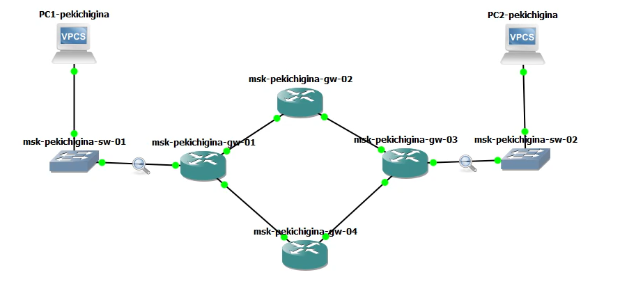{#fig:001 width=70%}

5. Присвойте IPv4-адреса оконечным устройствам PC1 и PC2 в соответствии
с данными в табл. 6.2. (рис. [-@fig:002]) (рис. [-@fig:003])

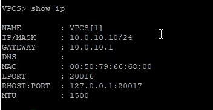{#fig:002 width=70%}

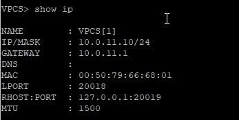{#fig:003 width=70%}

6. Настройте IPv4-адреса на интерфейсах маршрутизаторов:
msk-user-gw-01.(рис. [-@fig:004]) (рис. [-@fig:005])

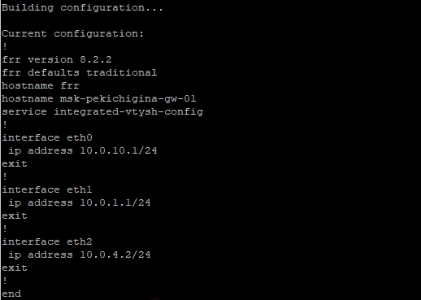{#fig:004 width=70%}

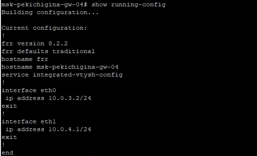{#fig:005 width=70%}

7. Присвойте IPv6-адреса оконечным устройствам PC1 и PC2 в соответствии
с данными в табл. 6.2.(рис. [-@fig:006])(рис. [-@fig:007])

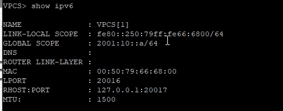{#fig:006 width=70%}

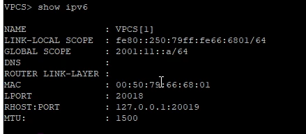{#fig:007 width=70%}

8. Настройте IPv6-адреса на интерфейсах маршрутизаторов:
msk-user-gw-01(рис. [-@fig:008])

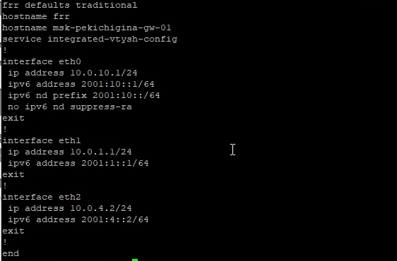{#fig:008 width=70%}

Настройка динамической маршрутизации по протоколу RIP.

1. На маршрутизаторах настройте RIP в качестве протокола динамической
маршрутизации.
2. Убедитесь, что маршрутизация по RIP настроена(рис. [-@fig:009])

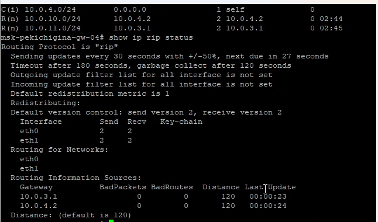{#fig:009 width=70%}

3. Проверьте пути прохождения пакетов:
– С PC1 пропингуйте PC2 и определите путь следования пакетов.(рис. [-@fig:010])

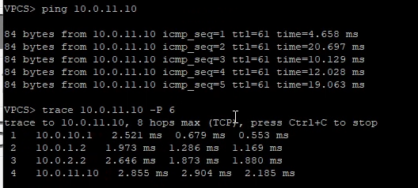{#fig:010 width=70%}

– Проверьте метрики протокола RIP:
msk-user-gw-01# show ip rip

– Предположим, что пакет проходит через маршрутизатор msk-user-gw-02
(в противном случае для дальнейших действий используйте маршрутиза-
тор msk-user-gw-04). Отключите на маршрутизаторе msk-user-gw-02
интерфейс.

– Проверьте метрики протокола RIP.

– С PC1 пропингуйте PC2 и определите путь следования пакетов. Отметьте
примерное время, за которое восстановится маршрут.

– Включите на маршрутизаторе msk-user-gw-02 интерфейс.

– С PC1 пропингуйте PC2 и определите путь следования пакетов.

– Посмотрите захваченный на соединениях трафик. В отчёте поясните, ка-
кую информацию можно извлечь из перехваченных пакетов.

4. На маршрутизаторах настройте RIPng для сетей IPv6.
5. Проверьте пути прохождения пакетов:
– С PC1 пропингуйте PC2 и определите путь следования пакетов:
PC1> ping 2001:11::a
PC1> trace 2001:11::a

– Проверьте метрики протокола RIPng:

msk-user-gw-01# show ipv6 ripng

– Предположим, что пакет проходит через маршрутизатор msk-user-gw-02
(в противном случае для дальнейших действий используйте маршрутиза-
тор msk-user-gw-04). Отключите на маршрутизаторе msk-user-gw-02
интерфейс.

– Проверьте метрики протокола RIPng:
msk-user-gw-01# show ipv6 ripng

– С PC1 пропингуйте PC2 и определите путь следования пакетов.

– Отметьте примерное время, за которое восстановится маршрут.

– Включите на маршрутизаторе msk-user-gw-02 интерфейс:.

– С PC1 пропингуйте PC2 и определите путь следования пакетов(рис. [-@fig:011])

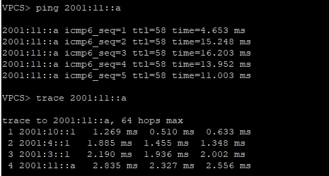{#fig:011 width=70%}

# Задание для самостоятельного выполнения

Требуется:

– заполнить таблицы

Адреса сетей в табл. [-@tbl:std-dir-3]

: Таблица адресов сетей {#tbl:std-dir-3}

| Устройства | Сеть IPv4 | Сеть IPv6 |
|---|---|---|
| PC1 – gw-01 | 10.10.1.96/27 | 2001:db8:1:1::/64 |
| PC2 – gw-02 | 10.10.1.64/28 | 2001:db8:1:6::/64 |
| gw-01 – gw-03 | 10.10.1.4/30 | 2001:db8:1:2::/64 |
| gw-02 – gw-04 | 10.10.1.8/30 | 2001:db8:1:3::/64 |
| gw-03 – gw-02 | 10.10.1.16/30 | 2001:db8:1:4::/64 |
| gw-04 – gw-02 | 10.10.1.32/30 | 2001:db8:1:5::/64 |

Адресация[-@tbl:std-dir-4]

: Таблица адресации {#tbl:std-dir-4}

| Устройство | Интерфейс | Адрес IP/префикс | Шлюз по умолчанию | Следующее устройство |
|---|---|---|---|---|
| gw-01 | eth0 | 10.10.1.97/27 | n/a | PC1 |
| gw-01 | eth0 | 2001:db8:1:1::1/64 | n/a | PC1 |
| gw-01 | eth1 | 10.10.1.5/30 | n/a | gw-03 |
| gw-01 | eth1 | 2001:db8:1:2::1/64 | n/a | gw-03 |
| gw-01 | eth2 | 10.10.1.9/30 | n/a | gw-04 |
| gw-01 | eth2 | 2001:db8:1:3::1/64 | n/a | gw-04 |
| gw-02 | eth0 | 10.10.1.65/28 | n/a | PC2 |
| gw-02 | eth0 | 2001:db8:1:6::1/64 | n/a | PC2 |
| gw-02 | eth1 | 10.10.1.18/30 | n/a | gw-03 |
| gw-02 | eth1 | 2001:db8:1:4::2/64 | n/a | gw-03 |
| gw-02 | eth2 | 10.10.1.33/30 | n/a | gw-04 |
| gw-02 | eth2 | 2001:db8:1:5::2/64 | n/a | gw-04 |
| gw-03 | eth0 | 10.10.1.6/30 | n/a | gw-01 |
| gw-03 | eth0 | 2001:db8:1:2::2/64 | n/a | gw-01 |
| gw-03 | eth1 | 10.10.1.17/30 | n/a | gw-02 |
| gw-03 | eth1 | 2001:db8:1:4::1/64 | n/a | gw-02 |
| gw-04 | eth0 | 10.10.1.10/30 | n/a | gw-01 |
| gw-04 | eth0 | 2001:db8:1:3::2/64 | n/a | gw-01 |
| gw-04 | eth1 | 10.10.1.34/30 | n/a | gw-02 |
| gw-04 | eth1 | 2001:db8:1:5::1/64 | n/a | gw-02 |
| PC1 | NIC | 10.10.1.98/27 | 10.10.1.97 | gw-01 |
| PC1 | NIC | 2001:db8:1:1::a/64 | n/a | gw-01 |
| PC2 | NIC | 10.10.1.66/28 | 10.10.1.65 | gw-02 |
| PC2 | NIC | 2001:db8:1:6::a/64 | n/a | gw-02 |

Топология сети (рис. [-@fig:012])

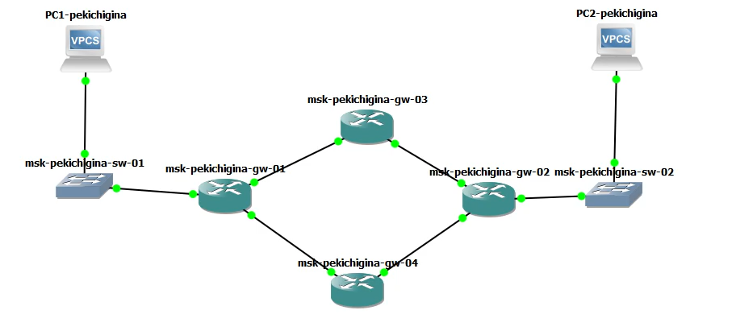{#fig:012 width=70%}

– настроить двойной стек IPv4 и IPv6, проверить соединения;(рис. [-@fig:013])(рис. [-@fig:014])

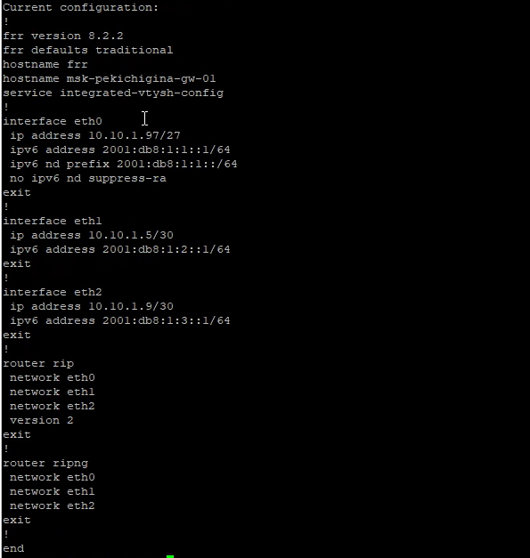{#fig:013 width=70%}

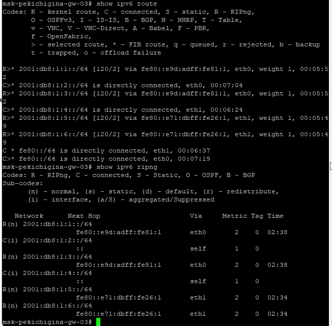{#fig:014 width=70%}

– настроить динамическую маршрутизацию сетей IPv4 и IPv6 для протокола
RIP, проверить соединения и маршруты.(рис. [-@fig:015])

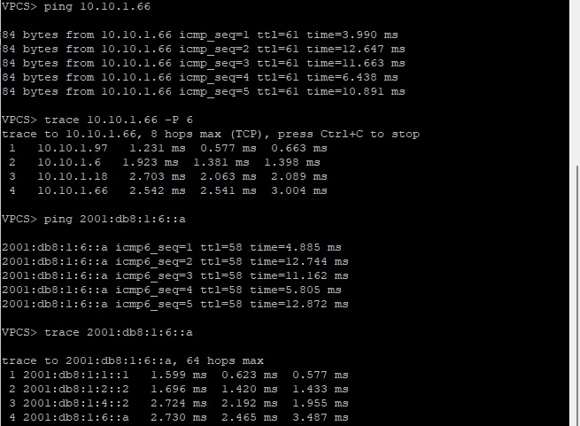{#fig:015 width=70%}

# Выводы

Мы изучили принципы маршрутизации по протоколу RIP в IPv4- и IPv6-сетях
и принципов настройки сетевого оборудования.

